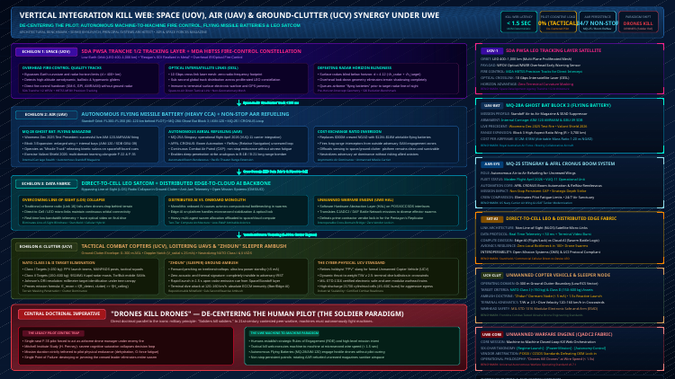
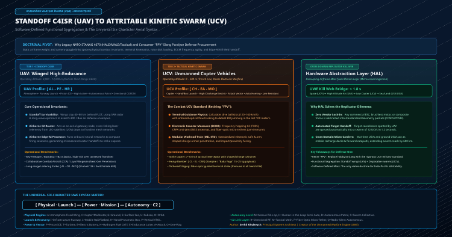

# SUBMISSION PACKAGE: AIR & SPACE FORCES MAGAZINE (FEATURE ESSAY)

### Editorial Submission Details

| Field | Detail |
| :--- | :--- |
| **Target Publication** | **Air & Space Forces Magazine** (`airandspaceforces.com`) |
| **Publisher** | Air & Space Forces Association (AFA), Arlington, VA |
| **Section** | Strategic Feature / Airpower Modernization & Future Warfare |
| **Recipient Editors** | **Tobias Naegele**, Editor in Chief (`tnaegele@afa.org`) **John A. Tirpak**, Editorial Director (`jtirpak@afa.org`) **General Editorial Desk**: `letters@afa.org` |
| **Submission Category** | Strategic Feature Analysis (~2,250 words) |
| **Author** | **Serhii Khylevych**, Principal Systems Architect |
| **Author Profile** | [LinkedIn: Serhii Khylevych](https://www.linkedin.com/in/serhii-khylevych-aa152322/) |
| **Manuscript Title** | *De-Centering the Pilot: Why Collaborative Combat Aircraft and CJADC2 Demand a "Drones Kill Drones" Architecture* |
| **Enclosed Assets** | Clean Word Manuscript (`.docx`), Reference Layout (`.pdf`), Dual High-Resolution Tactical Infographics (`air_space_vertical_integration_fitted.png`, `uav_ucv_architecture_fitted.png`) |

---

## PART 1: THE EDITORIAL PITCH (Cover Query to Air & Space Forces Magazine)

**To:** `tnaegele@afa.org`, `jtirpak@afa.org`  
**Subject:** FEATURE PROPOSAL: De-Centering the Pilot — Why CCA and CJADC2 Demand a "Drones Kill Drones" Architecture

Dear Tobias, John, and the Air & Space Forces Magazine Editorial Team,

As the U.S. Air Force accelerates its Collaborative Combat Aircraft (CCA) program through Increment 1 and prepares the ground for Increment 2, airpower doctrine faces an unaddressed operational bottleneck: our conceptual models remain stubbornly **pilot-centric**.

Current concepts assume that a single-seat fifth-generation fighter pilot—flying an F-35A or F-22 in contested airspace—can act as an airborne battle manager, commanding loyal wingmen while simultaneously executing air combat maneuvers. As rigorous research from the Mitchell Institute for Aerospace Studies has demonstrated, this expectation leads directly to catastrophic cognitive saturation. Tethering autonomous wings to human cockpits restricts mission endurance to human physical limits and creates a single, fatal point of failure under modern electronic warfare.

Drawing on four years of direct frontline systems engineering under bombardment in Ukraine, I have completed a comprehensive strategic feature (~2,250 words) examining the architectural shift required to achieve true all-domain air dominance:

**"De-Centering the Pilot: Why Collaborative Combat Aircraft and CJADC2 Demand a 'Drones Kill Drones' Architecture"**

The article explores five interconnected operational transitions:

1. **The "Soldier" Paradigm (Drones Kill Drones):** Establishing why machines must autonomously engage and suppress enemy machines at machine speed. Human commanders set high-level rules of engagement, but the tactical kill web must execute machine-to-machine, eliminating pilot cognitive saturation.
2. **The Autonomous Flying Battery (MQ-28 & AIM-120):** Building on the December 2025 Woomera live-fire milestone where the MQ-28A Ghost Bat launched an AIM-120 AMRAAM, the article outlines the transition to uncrewed "flying magazines" paired with Autonomous Aerial Refueling (AAR via MQ-25 / AFRL CRONUS). This enables non-stop persistent combat air patrols delivering weapons loads comparable to legacy strategic bombers without risking aircrew.
3. **The View from Orbit (Reagan’s SDI Realized in LEO):** Demonstrating how the Space Development Agency’s Proliferated Warfighter Space Architecture (PWSA) Tracking Layer and MDA HBTSS provide optical and infrared fire-control tracking from Low Earth Orbit, bypassing Earth-curvature radar horizons and delivering intercept-quality tracks directly to airborne shooters.
4. **Defeating Line-of-Sight Blackouts via Direct-to-Cell LEO:** Showing how space-based micro-telemetry and distributed Edge-to-Cloud AI resolve radio line-of-sight collapse when strike vectors descend into ground clutter, preventing onboard avionics bottlenecks during 100-plus drone saturation swarms.
5. **The Ground-Clutter Endgame (0–300 Meters):** Proving that air dominance ultimately hinges on neutralizing mobile adversary IADS (NATO Class I and Class II targets) hidden inside the ground-clutter Doppler notch, where high-altitude standoff sensors are blind and low-altitude copters (UCVs) and dormant sleeper ambushes deliver decisive kinetic strikes.

The complete manuscript is attached in Microsoft Word (`.docx`) and reference PDF (`.pdf`) formats, illustrated by two publication-grade tactical infographics depicting the vertical integration kill web and the cyber-physical UAV–UCV–UWE architecture.

All operational concepts and vehicle references are derived strictly from unclassified open-source intelligence (OSINT), public U.S. defense doctrine, and open engineering standards.

I would be honored to share this analysis with Air & Space Forces Magazine’s readership across Air Combat Command, the Space Force, and the aerospace industrial base.

Sincerely,

**Serhii Khylevych**  
Principal Systems Architect  
Creator of the Unmanned Warfare Engine (UWE)  
Kyiv, Ukraine  
LinkedIn: https://www.linkedin.com/in/serhii-khylevych-aa152322/

---

## PART 2: THE FEATURE MANUSCRIPT

# De-Centering the Pilot: Why Collaborative Combat Aircraft and CJADC2 Demand a "Drones Kill Drones" Architecture

### By Serhii Khylevych

---

### Technical & Operational Disclaimer
*This analytical feature is based exclusively on unclassified open-source intelligence (OSINT), officially released Department of Defense and allied program milestones, and public aerospace engineering literature. Tactical vehicle classifications, architecture models, and software taxonomies reflect conceptual benchmarks developed by the author for open defense standardization and do not disclose proprietary source code, operational flight program (OFP) data, or classified tactics, techniques, and procedures (TTPs).*

---

### I. The Cognitive Wall: The Limits of Pilot-Centric MUM-T

For a decade, Western airpower doctrine has sought to solve the math problem of contested skies through **Manned-Unmanned Teaming (MUM-T)**. Faced with the staggering procurement cost of fifth- and sixth-generation crewed platforms and the rapid proliferation of adversary integrated air defense systems (IADS), the U.S. Air Force championed **Collaborative Combat Aircraft (CCA)**. By pairing crewed stealth fighters with lower-cost, uncrewed "loyal wingmen," the service aims to project affordable mass into hostile anti-access/area-denial (A2/AD) bastions.

Yet, despite multi-billion-dollar investments across CCA Increment 1, Western doctrine remains trapped in a foundational flaw: **it is stubbornly pilot-centric**.

Current operational concepts envision the pilot of a single-seat F-35A Lightning II, an F-22 Raptor, or an E-7 Wedgetail mission commander acting as an airborne quarterback. In this model, an aviator traveling at Mach 1.4 under multi-G loading is expected to manage tactical sensors, evade surface-to-air missiles, maintain situational awareness, and simultaneously direct the flight paths, radar modes, electronic warfare emissions, and weapons releases of two to four uncrewed wingmen.

This assumption crashes against human biology. In her foundational study for the Mitchell Institute for Aerospace Studies, *Five Imperatives for Developing Collaborative Combat Aircraft for Teaming Operations*, senior resident fellow Heather Penney issued a stark warning: adding uncrewed aircraft to a formation does not inherently reduce workload. If human-machine teaming is poorly structured, the sheer volume of data streams, tasking approvals, and tactical micro-management will induce severe **pilot cognitive saturation**. In the dense electronic warfare environments of a peer conflict—where radio datalinks degrade, line-of-sight networks sever, and missile engagement timelines collapse to seconds—expecting a human pilot to micromanage robotic wingmen guarantees mission failure.

Furthermore, tethering uncrewed mass to crewed aircraft handcuffs the entire formation to human limitations:
1. **Endurance Constraints:** An uncrewed airframe can theoretically loiter for thirty hours with aerial refueling; a single-seat fighter pilot cannot survive beyond eight to ten hours without acute physical and cognitive degradation.
2. **Single Point of Failure:** An adversary integrated air defense system does not need to destroy five uncrewed wingmen; it only needs to kill the single crewed leader, immediately decapitating the formation.
3. **Speed of Action:** Tactical air combat in 2026 operates at computational machine speed. A pilot taking three to five seconds to parse an interface and authorize a defensive intercept is hopelessly behind the engagement cycle.

To realize the promise of affordable mass and the Combined Joint All-Domain Command and Control (CJADC2) enterprise, the Air Force must abandon the pilot-centric bottleneck. The future of contested air dominance belongs to **de-centered, machine-to-machine autonomy**.

---

### II. The "Soldier" Paradigm: Why Contested Skies Demand "Drones Kill Drones"

In the 1998 military science-fiction film *Soldier*, a cold operational truth is delivered to a commander seeking to replace veteran human fighters with engineered substitutes: **"Soldiers kill soldiers."** The phrase cuts through strategic euphemisms to define the brutal, reciprocal reality of armed conflict: when a military encounters an adversary capability, victory requires deploying an equivalent or superior force capable of operating under the same rules of engagement and physical brutality.

In twenty-first-century air warfare, the Pentagon faces an identical, inescapable reality: **Drones must kill drones.**

When adversary forces deploy thousands of low-observable loitering munitions, reconnaissance copters, cruise missiles, and uncrewed interceptors, human pilots cannot serve as the tactical executioners. Expecting an F-35 pilot firing a half-million-dollar AIM-9X or AMRAAM to engage swarms of attritable adversary drones is economically and tactically bankrupt. 

Under the **Unmanned Warfare Engine (UWE)** architecture, the operational paradigm shifts from *pilot-directed tasking* to *autonomous machine-to-machine kill webs*:
* **Strategic Command by Human Intent:** Human commanders establish high-level Rules of Engagement (ROE), designate defensive corridors, allocate resource budgets, and retain ultimate systemic authority.
* **Tactical Execution by Machine Speed:** Within defined ROE, uncrewed systems detect, classify, prioritize, and neutralize hostile uncrewed vectors autonomously across microsecond timelines (< 1.5 seconds).
* **Decoupled Combat Cycles:** The survival of an uncrewed defensive formation is never dependent on maintaining continuous datalink line-of-sight with a crewed cockpit.

To execute this "Drones Kill Drones" reality, airpower cannot rely on a single monolithic drone tier. It demands a fully synchronized, vertically integrated kill web spanning from low Earth orbit to the ground-clutter layer.

---

---

### III. The Autonomous Flying Battery: MQ-28, AIM-120, and Non-Stop Aerial Refueling

As illustrated in **Figure 1**, the airborne standoff layer of this vertical kill web is anchored by a new operational asset: **The Autonomous Flying Missile Battery**.

A decisive milestone toward this doctrine occurred in **December 2025 at the Woomera Range Complex in South Australia**, where the Royal Australian Air Force and Boeing successfully executed the first live-fire separation test of an **AIM-120 AMRAAM missile from an MQ-28A Ghost Bat**. Demonstrating the ability of an uncrewed platform to carry, cue, and launch radar-guided air-to-air interceptors internally, the test validated that Collaborative Combat Aircraft can function as lethal kinetic magazines rather than merely sensor decoys.

In the **Block 3 configuration**, the Ghost Bat design matures this concept with enlarged, higher-aspect-ratio wings for extended range and reconfigured internal weapons bays capable of housing multiple AIM-120s or GBU-39 Small Diameter Bombs while preserving broadband low-observable signatures. Deployed in June 2026 during **Exercise Valiant Shield**, the MQ-28 operated alongside F-22s and F-35s across the Western Pacific, demonstrating how uncrewed missile carriers multiply the combat persistence of frontline formations.

However, an uncrewed flying magazine achieves its true strategic potential only when liberated from runway logistics through **Autonomous Aerial Refueling (AAR)**:
* **The Carrier and Land-Based Tanker Precedent:** With the U.S. Navy’s **MQ-25A Stingray** achieving its maiden operational flight in April 2026 and standing up fleet integration with Unmanned Carrier-Launched Multi-Role Squadron 11 (VUQ-11), uncrewed tanking has shifted from research to fleet reality.
* **AFRL CRONUS and Boom Automation:** The Air Force Research Laboratory’s **Combat Refueling and Operations Network User System (CRONUS)** program has matured automated tanker boom control and Relative Navigation (RelNav) algorithms, enabling uncrewed receiver aircraft to safely rendezvous, connect, and take fuel without human hands on the controls.

By cycling through automated tanker orbits, uncrewed flying missile batteries achieve **non-stop persistence (24/7 combat air patrols)**. Operating 80 to 120 kilometers behind the forward line of own troops (FLOT), these platforms provide standing air-defense magazines delivering weapons payloads comparable to a B-1B Lancer or B-21 Raider—firing salvos into contested corridors on off-board cues, completely decoupled from aircrew duty cycles.

---

### IV. The View from Orbit: Ronald Reagan’s Vision Realized in Low Earth Orbit

Forty years after President Ronald Reagan delivered his historic March 23, 1983 address proposing the **Strategic Defense Initiative (SDI)**, the dream of comprehensive space-based tracking has ceased to be an exotic science-fiction concept or a multi-billion-dollar geostationary pipe dream. Under the **Space Development Agency (SDA)**, it is being mass-produced in proliferated Low Earth Orbit (pLEO).

The **Proliferated Warfighter Space Architecture (PWSA)**—specifically the **Tracking Layer (Tranche 1 and Tranche 2)** operating in tandem with the Missile Defense Agency’s **Hypersonic and Ballistic Tracking Space Sensor (HBTSS)**—revolutionizes air and missile defense:
* **Overhead Geometry vs. Earth Curvature:** Surface-based radars are trapped by spherical geometry. The standard radar horizon equation:
  $$d_{\text{horizon}} \approx 4.12 \cdot (\sqrt{h_{\text{radar}}} + \sqrt{h_{\text{target}}})$$
  dictates that a surface radar mast cannot detect targets skimming terrain dozens of kilometers away. 
* **Fire-Control Quality from Space:** Operating at altitudes of 400 to 1,000 kilometers, the SDA Tracking Layer looks *downward* onto the atmosphere. Using wide-field-of-view (WFOV) and medium-field-of-view (MFOV) multi-spectral infrared sensors, these satellites detect the thermal signatures of aircraft, cruise missiles, and hypersonic glide vehicles against the cold background of the Earth.
* **Laser Mesh Distribution:** Utilizing 10 Gbps Optical Intersatellite Links (OISL), track data travels across the orbital constellation at the speed of light, bypassing terrestrial communications nodes and hostile jamming before beaming down directly to tactical networks.

By providing **fire-control quality tracks** from space directly to airborne flying batteries (MQ-28/AIM-120), the orbital layer enables **pre-horizon intercepts**. A flying magazine can launch an air-to-air missile at a hostile vector long before that target appears on any terrestrial radar scope. Reagan’s defensive shield has transformed into an active, distributed offensive kill web.

---

### V. Defeating Line-of-Sight Blackouts: Direct-to-Cell LEO & Distributed Edge-to-Cloud AI

While space-based tracking and airborne flying magazines dominate medium and high altitudes, the ultimate battle for air dominance is fought in the low-altitude boundary. Yet, the moment uncrewed strike vectors descend into valleys and tree lines to evade adversary air defenses, traditional military communications collapse.

Line-of-Sight (LOS) directional datalinks (such as Link 16 or tactical UHF/VHF radios) require an unobstructed straight line between the aircraft and the drone. The moment a terrain feature intervenes, or the platform drops below the radar horizon, **the datalink goes black**.

To close this seam, the UWE architecture integrates commercial and military satellite convergence:
1. **Direct-to-Cell / LEO Satellite Micro-Links:** By integrating low-SWaP (size, weight, and power) transceivers compatible with proliferated low-orbit constellations (such as Starshield and commercial Direct-to-Device LEO arrays), low-altitude drones maintain continuous, non-line-of-sight connectivity. Even when flying thirty meters above ground level inside deep ravines, vectors transmit low-bitrate state telemetry and receive updated target bounding boxes without requiring an overhead crewed relay aircraft.
2. **Terminal Burst Video:** When human-in-the-loop verification is mandated by ROE, the system avoids continuous high-bandwidth video streaming (which acts as a beacon for adversary direction-finding). Instead, it transmits ultra-low-latency, five-second compressed video bursts during the terminal dive phase, confirming positive target identification.

Simultaneously, this architecture resolves the **onboard computing bottleneck**. Defense tech startups frequently promise "full onboard autonomy," attempting to pack massive neural networks into the avionics boxes of expendable drones. Under the high-G stress and thermal load of combat, these monolithic computers overheat, crash, or introduce severe latency during massive saturation swarm attacks.

The UWE model implements **Distributed Edge-to-Cloud AI**:
* **Onboard Edge-AI:** The drone’s local processors perform only time-critical, deterministic tasks: flight dynamics stabilization, inertial-optical dead reckoning, and real-time bounding-box lock on target silhouettes during the final 500 meters of flight.
* **Off-Board Cloud/Space AI:** Global swarm coordination, dynamic route deconfliction, and threat prioritization are computed in off-board space or standoff nodes and delivered as lightweight micro-commands over the LEO link.

This separation keeps expendable drones cheap, reliable, and immune to local computational freezes.

---

### VI. Ground-Clutter Strike: Neutralizing NATO Class I & II Assets at 0–300 Meters

The ultimate purpose of the vertical kill web is not merely to dominate clean skies, but to dismantle the adversary’s anti-access infrastructure on the ground.

As demonstrated by four years of combat in Ukraine, high-altitude surveillance platforms carrying 50-kilogram optical gimbals (the Heavy Gimbal Paradox) fail against disciplined adversaries. Modern air defense systems do not sit in the open; they employ camouflage, multispectral smoke, and tactical radar cycling. Furthermore, the true threat to allied air operations comes from dispersed, low-RCS assets:
* **NATO Class I Targets (< 150 kg):** Mobile FPV launch teams, loitering munition operators, and concealed MANPADS teams concealed in tree lines.
* **NATO Class II Targets (150–600 kg):** Mobile air defense search radars (such as the Russian 9S18M1 "Kupol"), Tor-M2 and Buk-M3 tracked launchers, and mobile electronic warfare systems (e.g., Borisoglebsk-2, Zhitel).

Detecting and resolving these small, camouflaged assets from 25,000 feet through cloud decks and oblique slant angles is an optical impossibility. The mission formula of tactical reconnaissance is dictated by **target detection resolution, not arbitrary flight ceilings**:
$$E_{\text{recon}} = f(R_{\text{detect}}^{\text{Class I/II}}, \sigma_{\text{clutter}}, \tau_{\text{latency}}) \gg f(H_{\text{ceiling}}, T_{\text{endurance}})$$

Air dominance requires entering the **ground-clutter envelope (0–300 meters AGL)**. By skimming terrain at low altitudes, attritable unmanned copters (**UCVs**) and winged loitering munitions exploit radar backscatter and fly below adversary acquisition radars’ Doppler notch velocity ($V_{\text{radial}} \le 25\text{ m/s}$).

Crucially, this layer introduces the **"Zhdun" (Sleeper) Ground Ambush**:
1. Combat UCVs fly forward at night and land on rooftops, high-tension power towers, or tree lines along predicted adversary ingress corridors.
2. In dormant standby, the platform powers down all active emitters, drawing under 5 milliamps of current. With zero acoustic noise and zero thermal signature, it is completely invisible to adversary aerial radar and infrared search-and-track (IRST) sensors.
3. When the Space Tracking Layer or standoff ELINT vectors detect an adversary mobile radar radiating or an enemy drone swarm launching, an encrypted micro-wake cue is broadcast over the Direct-to-Cell satellite link.
4. The dormant UCV powers up its motors and takes flight in **1.5 seconds**, launching an immediate, high-velocity dive attack (120–160 km/h) against the radiating radar mast from point-blank range (1 to 3 kilometers away).

The hunter becomes the hunted, completely neutralizing the enemy air defense network from the ground up.

---

---

### VII. The Software-Defined Convergence: Universal Hardware Abstraction (UWE HAL)

To translate this multi-tier vertical vision into operational reality across the Department of the Air Force, the military cannot allow prime defense contractors to build closed, proprietary vertical stacks for each drone program.

As illustrated in **Figure 2**, the **Unmanned Warfare Engine (UWE)** establishes an open, software-defined **Hardware Abstraction Layer (HAL)** built on POSIX-compliant, Open Mission Systems (OMS), and Universal Command and Control Interface (UCI) standards:
* **The Six-Character Taxonomy:** Every uncrewed vector across all domains—whether a high-altitude loyal wingman, an orbital sensor, or a ground-clutter tactical copter—is governed by a deterministic, six-character operational syntax (`[Regime·Launch] - [Power·Mission] - [Autonomy·Control]`).
* **Decoupling Software from Airframes:** An autonomous battle management microservice running within the DAF Battle Network / CJADC2 data fabric does not need to know the specific motor timing or battery chemistry of an attritable drone. The UWE HAL translates high-level tasking ("Suppress Emitter at Coordinate X") into low-level cyber-physical actuation.
* **Defeating Vendor Lock-In:** By establishing vendor-agnostic hardware abstraction, the Air Force can purchase airframes as commoditized, consumable mass from hundreds of commercial manufacturers while maintaining a unified, combat-hardened autonomy core for the Pentagon’s **Replicator** initiative.

---

### Conclusion: The Mandate for Increment 2

The U.S. Air Force stands at an inflection point. Collaborative Combat Aircraft Increment 1 has successfully established the technical feasibility of uncrewed loyal wingmen. But if Increment 2 simply replicates twentieth-century fighter doctrine—building beautiful, $\$20\text{ million}$ unmanned jets tethered to the cognitive bandwidth of exhausted human pilots—it will fail the test of peer conflict.

True air dominance requires de-centering the pilot. By operationalizing the **"Drones Kill Drones"** doctrine, connecting space-based fire-control tracking with autonomous flying missile batteries, sustaining continuous presence through uncrewed aerial refueling, and linking ground-clutter sleeper ambushes via LEO satellite micro-links, the Air Force can field an unassailable, multi-tier kill web.

Machines must fight machines. The human commander’s role is to direct the campaign; the kill web’s mandate is to execute at wire speed.

---

### About the Author
**Serhii Khylevych** is a Principal Systems Architect and the creator of the Unmanned Warfare Engine (UWE). He has spent the last four years engineering and deploying combat-tested autonomous unmanned systems, tactical command-and-control networks, and hardware abstraction architectures under direct operational bombardment in Ukraine.  
*Contact: [LinkedIn Profile](https://www.linkedin.com/in/serhii-khylevych-aa152322/)*
