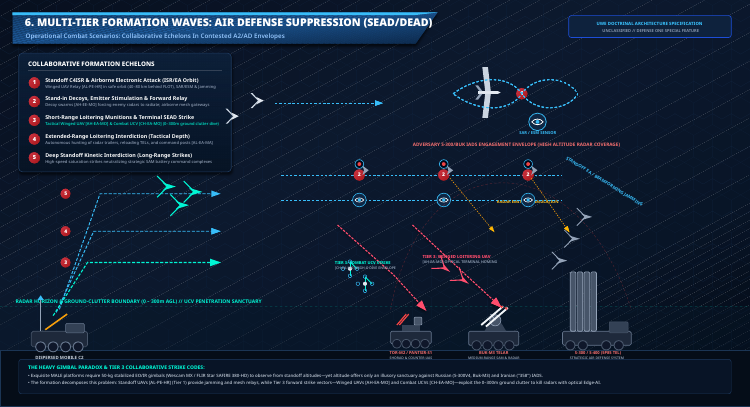

# SUBMISSION PACKAGE: DEFENSE ONE (IDEAS & COMMENTARY)

### Editorial Submission Details

| Field | Detail |
| :--- | :--- |
| **Target Publication** | **Defense One** (`defenseone.com`) |
| **Section** | Ideas & Commentary / Tech & Acquisition |
| **Recipient Editors** | **Bradley Peniston**, Executive Editor (`bpeniston@defenseone.com`) **Patrick Tucker**, Science & Technology Editor (`ptucker@defenseone.com`) General Submissions Desk: `ideas@defenseone.com` |
| **Submission Category** | Featured Commentary / Strategic Op-Ed (~1,450 words) |
| **Author** | **Serhii Khylevych**, Principal Systems Architect |
| **Author Profile** | [LinkedIn: Serhii Khylevych](https://www.linkedin.com/in/serhii-khylevych-aa152322/) |
| **Manuscript Title** | *Why the Pentagon Must Retire "FPV": Introducing Multi-Tier Swarm Formations and the UCV Standard for Massed Air Combat* |
| **Enclosed Assets** | Clean Word Manuscript (`.docx`), Print Layout (`.pdf`), High-Resolution 300 DPI Tactical Architecture Infographic (`defense_one_formation_waves.png`) |

---

## PART 1: THE EDITORIAL PITCH (Cover Query to Defense One)

**To:** `ideas@defenseone.com`, `bpeniston@defenseone.com`, `ptucker@defenseone.com`  
**Subject:** OP-ED SUBMISSION: Why the Pentagon Must Retire "FPV" — Multi-Tier Formations & The UCV Standard for Software-Defined Air Combat

Dear Bradley, Patrick, and the Defense One Editorial Team,

As the Pentagon accelerates its **Replicator** initiative to counter mass with mass across contested theaters, defense acquisition faces an unaddressed conceptual bottleneck: our military doctrine and procurement programs are adopting consumer hobbyist slang while struggling to overcome modern Integrated Air Defense Systems (IADS).

I have completed a targeted operational commentary (~1,450 words) analyzing why relying on the term **"FPV"** paralyzes defense industrial scaling, explaining how modern Russian and Iranian air defenses defeat monolithic drones through **The Heavy Gimbal Paradox**, and proposing an actionable operational framework: the multi-tier UAV/UCV formation battle loop and the software-defined **Unmanned Copter Vehicle (UCV)** military standard:

**"Why the Pentagon Must Retire FPV: Introducing Multi-Tier Swarm Formations and the UCV Standard for Massed Air Combat"**

On the front lines of Ukraine, the colloquial term "FPV" was the natural product of grassroots battlefield improvisation. But when defense ministries, Pentagon program managers, and NATO standardizers adopt hobbyist slang, it poisons defense procurement. "First Person View" merely describes an analog or digital video link to a pilot’s goggles—a consumer label inherited from 2015 drone racing. It communicates nothing to an engineer or acquisition officer about terminal dive ballistics, electronic counter-countermeasures (ECCM), rotor disk loading, modular explosive train safety (MIL-STD-1316), or edge-AI optical autonomy.

Furthermore, attempting to solve contested airspace with high-altitude, single-platform drones creates **The Heavy Gimbal Paradox**: to peer into contested areas from standoff distances, platforms must carry heavy 50-kg stabilized EO/IR turrets (Wescam MX, Teledyne FLIR Star SAFIRE 380-HD), inflating airframe mass to thousands of kilograms and unit costs to $20M–$30M. Yet, high altitude provides only an illusion of safety against Russian (S-300V4, Buk-M3) and Iranian (loitering SAM "358") air defenses.

This article outlines three actionable operational shifts:
1. **The Multi-Tier Formation Battle Loop (Figure 1):** Decomposing air defense suppression (SEAD/DEAD) into five synchronized echelons: Standoff C4ISR and Electronic Attack orbits (Tier 1 `AL-PE-HR`), forward stand-in decoys stimulating enemy radar emissions (Tier 2 `AH-EE-MO`), and low-altitude terminal strike vectors (Tier 3) combining Winged Loitering UAVs (`AH-EA-MO`) and agile Combat UCVs (`CH-EA-MO`) penetrating in the 0–300m ground-clutter layer.
2. **Tactical Mechanics & The "Zhdun" Sleeper Mode:** Overcoming multirotor energy limits by enabling forward UCVs to land on rooftops and terrain features in power-down sleeper mode, executing zero-warning ambushes upon radar stimulation.
3. **The Universal Six-Character Syntax & Hardware Abstraction Layer (HAL):** Ingesting commoditized commercial airframes into military command meshes via standardized POSIX/CCSDS interfaces without prime-contractor vendor lock-in.

The complete manuscript is attached in Microsoft Word (`.docx`) and reference PDF (`.pdf`) formats, along with a high-resolution 300 DPI tactical architecture diagram illustrating the complete multi-tier formation battle loop.

All operational models and taxonomies are derived strictly from unclassified open-source intelligence (OSINT), public military doctrine, and open engineering standards, with vehicle benchmarks explicitly designated for OEM and acquisition validation against certified technical specifications (TTX).

I would be honored to share this perspective with Defense One’s readership across the Pentagon, DIU, and the defense industrial base.

Sincerely,

**Serhii Khylevych**  
Principal Systems Architect  
Creator of the Unmanned Warfare Engine (UWE)  
Kyiv, Ukraine  
LinkedIn: https://www.linkedin.com/in/serhii-khylevych-aa152322/

---

## PART 2: THE COMPLETE OP-ED MANUSCRIPT

# Why the Pentagon Must Retire "FPV": Introducing Multi-Tier Swarm Formations and the UCV Standard for Massed Air Combat

### By Serhii Khylevych

---

### Technical & Operational Disclaimer

> **DISCLAIMER ON SOURCES AND OEM ENCODING VALIDATION:**  
> All operational models, taxonomies, and architectural frameworks presented herein are derived exclusively from unclassified open-source intelligence (OSINT), public military doctrine publications, and open international engineering standards (CCSDS, POSIX, OMG DDS). Specific vehicle classifications and alphanumeric codes cited as examples serve as illustrative architectural benchmarks. Formal operational adoption, baseline encoding, and deployment of these classifications require empirical validation and certification by original equipment manufacturers (OEMs) and military acquisition authorities against current certified technical performance specifications (TTX).

---

As the Pentagon accelerates its **Replicator** initiative to field attritable autonomous systems across contested theaters, defense acquisition faces an unaddressed doctrinal bottleneck. In military programs, language dictates procurement. Yet, while the Department of Defense seeks to counter mass with mass, its program offices and technical solicitations remain trapped in consumer hobbyist slang: specifically, the ubiquitous term **"FPV"**.

On the front lines of Ukraine, colloquial slang like "FPV" was the natural product of grassroots battlefield improvisation. But when defense ministries, NATO standardizers, and prime contractors adopt hobbyist jargon in formal doctrine, it poisons defense procurement. Calling a precision-guided loitering munition an "FPV drone" is as doctrinally absurd as classifying the M4 rifle as a "red-dot firearm" or designating an air-to-air missile as a "heads-up-display rocket."

First Person View (FPV) merely describes an analog or digital video protocol streaming imagery to a pilot’s goggles—a consumer label inherited from 2015 drone racing. It communicates nothing about the physical and cybernetic invariants governing combat lethality: terminal dive ballistics, rotor disk loading, electronic counter-countermeasures (ECCM), optical target tracking, and modular explosive train safety. To field resilient, industrial-scale attritable air power, the Pentagon must retire "FPV" and formally establish the **Unmanned Copter Vehicle (UCV)** standard.

---

### The Fall of the MALE Sanctuary and the Heavy Gimbal Paradox

This lexicon failure coincides with the collapse of twentieth-century airframe taxonomy. For three decades, Western air forces evaluated unmanned aviation through **NATO STANAG 4670** altitude tiers: High-Altitude Long-Endurance (HALE), Medium-Altitude Long-Endurance (MALE), and Tactical UAS. Under this paradigm, exquisite, non-stealthy MALE platforms—exemplified by the MQ-9 Reaper and Bayraktar TB2—dominated permissive counter-insurgency environments.

Contested airspace in Ukraine and the Middle East permanently shattered this sanctuary. Dense ground-based air defenses (GBAD)—integrating Russian S-300V4, Buk-M3, and Tor-M2 complexes, or Iranian interceptors including the "358" loitering surface-to-air missile—combined with multi-layered electronic warfare barrages to drive high-altitude non-stealthy airframes from the battlespace.

This operational reality created **The Heavy Gimbal Paradox**. To observe targets from safe standoff distances (40 to 80 kilometers) outside adversary missile engagement zones, an aircraft must carry heavy, multi-million-dollar electro-optical/infrared (EO/IR) sensor gimbals (such as 50-kg class Wescam MX-15/20 or Teledyne FLIR Star SAFIRE 380-HD turrets) with large optical apertures and high focal lengths. 

These massive sensor payloads inflate airframe gross takeoff weight, driving unit costs to $20M–$30M. Yet, high altitude provides only an **illusion of sanctuary**: against modern multi-channel SAM complexes, a large, non-maneuvering MALE platform is an illuminated beacon. The single exquisite platform is tactically bankrupt. The solution is **software-defined functional segregation** through collaborative multi-tier formation waves.

---

### Multi-Tier Formation Waves: The 5-Phase Battle Loop

To dismantle layered adversary air defenses (SEAD/DEAD), the unmanned air domain must decompose sensing, electronic attack, and kinetic delivery into synchronized collaborative echelons.

As illustrated in **Figure 1**, modern air combat operations deploy five distinct, interoperable formation waves:

1. **Tier 1: Standoff C4ISR & Airborne Electronic Attack (The Relay Orbit):** High-altitude winged platforms—designated **`AL-PE-HR`** (Atmosphere fixed-wing, Runway launch, Piston powerplant, High-endurance, Autonomous patrol, Directional RF link)—operate in protected racetrack orbits 40 to 80 kilometers behind the forward line of own troops (FLOT). Equipped with synthetic aperture radar (SAR), electronic support measures (ESM), and directional phased-array jamming, Tier 1 suppresses adversary acquisition radars without entering SAM engagement envelopes.
2. **Tier 2: Stand-in Decoys & Emitter Stimulation:** Low-cost, expendable forward decoys (**`AH-EE-MO`**) penetrate into the adversary radar horizon. Their mission is active emitter stimulation: forcing hostile tracking and fire-control radars (e.g., Russian 9S18 Kupol or 9S36 radars) to radiate, commit missile channels, and expose their precise coordinates to the Kill Web.
3. **Tier 3: Short-Range Tactical Strike Vectors (Winged UAV & Combat UCV):** Operating strictly within the **0 to 300 meter ground-clutter layer**, Tier 3 deploys a synchronized mix of **Winged Loitering UAVs (`AH-EA-MO`)** and **Agile Combat UCVs (`CH-EA-MO`)**. Screened by the radar horizon and terrain masking, these low-altitude vectors close undetected. Upon receiving target handoff, they execute steep, high-G terminal dive attacks directly onto illuminated radar antennas and launcher rails.
4. **Tier 4: Extended-Range Loitering Interdiction:** Medium-range loitering platforms (**`AL-EA-MA`**) conduct autonomous target hunting in the adversary tactical depth, interdicting mobile reload transports and repositioning launchers.
5. **Tier 5: Deep Standoff Kinetic Interdiction:** High-speed kinetic saturation vectors (**`AL-JA-TA`**) deliver heavy standoff warheads to neutralize hardened command bunkers and strategic battery infrastructure.

---

### Tactical Mechanics: Ground Clutter, Edge-AI, and the "Zhdun" Sleeper Mode

The central engineering constraint of multirotor copters (UCVs) is aerodynamic energy density: lifting mass purely through rotor thrust restricts flight endurance compared to fixed-wing gliders. 

To turn this physical constraint into a tactical advantage, the architecture introduces the **"Zhdun" (Ambusher/Sleeper) operational mode**. 

Instead of burning battery reserves loitering in mid-air, forward UCVs fly low into contested sectors and land on forward rooftops, tree lines, or elevated terrain features. Once grounded, the UCV powers down its propulsion system entirely, reducing acoustic and thermal signatures to zero. Operating on milliwatt-level passive standby power, the sleeper node acts as an invisible, attritable minefield. 

When Tier 1 or Tier 2 forces an adversary radar to radiate, or when a mobile TEL moves into the sector, the sleeper UCV powers its motors, lifts off within 1.5 seconds, and executes a terminal dive attack before the target can initiate countermeasures. Crucially, onboard **Edge-AI optical trackers** execute autonomous target lock-on in the terminal phase, eliminating reliance on fragile RF pilot video streams during the final 100 meters under heavy electronic jamming.

---

### The Universal Six-Character Aerial Syntax

To coordinate this multi-tier Kill Web without proprietary software barriers, the **Unmanned Warfare Engine (UWE)** architecture establishes an idempotent, dual-read six-character syntax readable by both operational commanders and onboard tactical AI processors:

$$\mathbf{Aerial	ext{ }Platform} = [\mathbf{Regime} \cdot \mathbf{Launch}] - [\mathbf{Powerplant} \cdot \mathbf{Mission}] - [\mathbf{Autonomy} \cdot \mathbf{Control}]$$

$$[\mathbf{O}\mathbf{P}] - [\mathbf{E}\mathbf{M}] - [\mathbf{T}\mathbf{C}]$$

Under this taxonomy, an asset identity is defined by physical invariants rather than commercial marketing labels:
* **`AL-PE-HR` (Standoff UAV Relay):** Atmosphere fixed-wing (**A**), runway infrastructure (**L**), piston engine (**P**), high-altitude endurance (**E**), autonomous patrol (**H**), directional COFDM phased-array datalink (**R**).
* **`AH-EA-MO` (Tactical Winged Loitering UAV):** Atmosphere fixed-wing (**A**), hand/canister launch (**H**), electric powerplant (**E**), attack vector (**A**), autonomous optical lock (**M**), radio-silent mesh link (**O**).
* **`CH-EA-MO` (Tactical Combat UCV):** Copter vertical-lift (**C**), hand/canister launch (**H**), high-discharge electric powertrain (**E**), terminal attack vector (**A**), autonomous optical terminal homing (**M**), radio-silent mesh or tethered link (**O**).

---

### The Combat UCV Standard: Defining Physics Over Slang

Replacing "FPV" with the formal **Unmanned Copter Vehicle (UCV)** class shifts defense acquisition from hobbyist parts-bin shopping to rigorous cyber-physical engineering. A combat UCV is defined by four core engineering invariants:

1. **Terminal Guidance Physics & Aerodynamic Ballistics:** Unlike horizontal-flight loitering munitions, a tactical multirotor operates across high-agility vertical and dive vectors. Achieving terminal velocities of 120 to 160 km/h under crosswinds requires high rotor disc loadings and dynamic thrust-to-weight ratios ($T/W \ge 2.5$).
2. **Electronic Counter-Countermeasures (ECCM):** Consumer video links collapse within hours of electronic attack. A combat-grade UCV requires frequency-hopping spread spectrum (FHSS) links, circularly polarized anti-jam GNSS arrays, or fiber-optic micro-tethers offering complete immunity to radio-frequency jamming.
3. **Modular Warhead Train (MIL-STD-1316):** Military utility demands transitioning from dangerous improvised wiring to standardized electronic safe-and-arm devices (ESAD), modular shaped charges, and programmable proximity fuzes.
4. **Energy Density & Discharge Profiles:** High-rate lithium-ion (21700 cells) and lithium-polymer batteries engineered for continuous high-discharge current ($45	ext{–}60	ext{C}$ burst) during combat egress and terminal acceleration.

---

### Operationalizing Replicator: Hardware Abstraction vs. Vendor Lock-In

The ultimate strategic benefit of the UCV standard is solving the Pentagon's **vendor lock-in dilemma**. Historically, military acquisitions bound software to proprietary airframe hardware, creating multi-year redesign bottlenecks whenever electronic warfare environments shifted.

The UWE architecture introduces a software-defined **Hardware Abstraction Layer (HAL)**. Mission logic, automated target-recognition (ATR) pipelines, and cooperative swarm algorithms treat underlying airframes as commoditized, swappable execution vectors. Whether procuring carbon-fiber frames from Ohio, motor speed controllers from Texas, or motors from domestic commercial suppliers, hardware is dynamically ingested into the command mesh via standardized POSIX/CCSDS interfaces in microseconds.

Furthermore, this abstraction enables seamless **cross-domain handoff**: an airborne UAV relay detecting an emitter can transmit coordinates across tactical meshes to naval (USV) or ground (UGV) units, triggering coordinated UCV swarm launches in seconds.

---

### Conclusion: Software-Defined Air Superiority

The United States cannot achieve the scale mandated by the Replicator initiative using twenty-year-old airframe taxonomies, nor can it secure contested airspace by adopting the vocabulary of weekend hobbyists. 

By retiring "FPV," adopting the rigorous **UCV standard**, operationalizing **multi-tier formation waves**, and deploying a software-defined hardware abstraction layer, the Pentagon can bridge the divide between commercial mass and military lethality—turning attritable air mass into decisive combat power.

***

**About the Author:**  
*Serhii Khylevych is a Principal Systems Architect and creator of the Unmanned Warfare Engine (UWE) meta-architecture. He possesses over two decades of engineering leadership in mission-critical telecommunications, distributed autonomous systems, and defense hardware abstraction.*  
*LinkedIn: [linkedin.com/in/serhii-khylevych-aa152322](https://www.linkedin.com/in/serhii-khylevych-aa152322/)*
