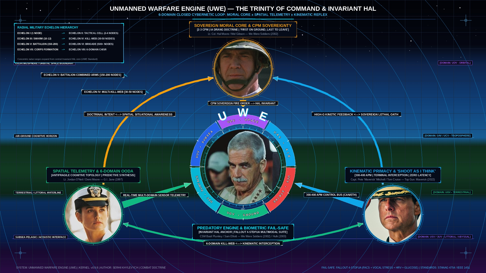
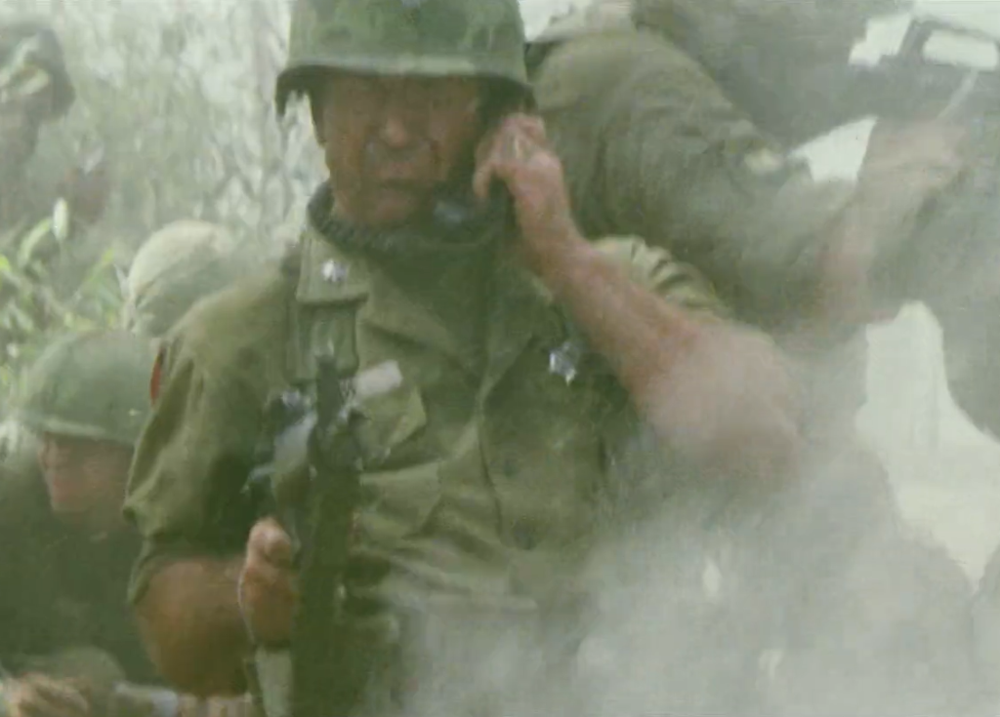
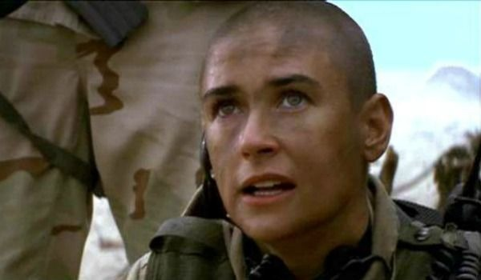

# The Cyber-Physical Officer: Human-Machine Symbiosis in the Unmanned Warfare Engine (UWE)

### Beyond "Twitch-Reflexes": The Moore-Plumley Paradigm, APM vs. CPM Discrimination, and the "I Shoot As I Think" Doctrine

**Author:** Serhii Khylevych  
*Systems Architect, MilTech Strategist & Founder of the Unmanned Warfare Engine (UWE)*  
* **Live on LinkedIn Pulse:** [Read Article](https://www.linkedin.com/pulse/cyber-physical-officer-human-machine-symbiosis-engine-khylevych-pkjff)  

---

> ⚠️ **EPISTEMOLOGICAL DISCLAIMER & SYSTEM BOUNDARIES**  
> *The author of this architecture does not hold authorization to cite classified operational after-action reports (AARs) or restricted multi-domain tactical telemetry datasets of sovereign states. Consequently, the cinematic case studies referenced herein (Top Gun: Maverick, G.I. Jane, We Were Soldiers, Lie to Me) are utilized strictly as non-linear conceptual metaphors and qualitative cognitive models.*  
> *These references serve as pedagogical stress-test vehicles to evaluate the extreme limits of human-machine interaction, reflex synchronization, and real-time cybernetic fail-safes. They are not intended, nor should they be interpreted, as prescriptive tactical instructions or direct operational mandates. They represent an abstract framework designed to evaluate human cognitive bandwidth under high-intensity kinematic stress.*

---

## 🌟 Dedications & Deep Gratitude

This architectural model was forged in Kyiv amidst the existential realities of multi-domain asymmetric warfare. The cognitive framework detailed here would have been impossible without the profound inspiration of legendary actors and the dialogue of international peers.

### 🎖️ The Legendary Actors & Their Tactical Phenotypes
We extend our deepest gratitude for the extraordinary motivation, character archetypes, and cultural grounding provided by:

* **Sam Elliott** as *CSM Basil Plumley* in [**We Were Soldiers (2002)**](https://www.imdb.com/title/tt0277434/) & *Gen. Ross* in [**Hulk (2003)**](https://www.imdb.com/title/tt0286716/):  
  The archetype of the unyielding, predatory Master Sergeant. His legendary "Old Iron Jaw" calm under artillery fire provided the behavioral baseline for the **UWE Engine itself**—a tireless, incorruptible cyber-physical executor maintaining logistical and tactical order across battlefield friction. ([Sam Elliott IMDb](https://www.imdb.com/name/nm0000385/))

* **Mel Gibson** as *Lt. Col. Harold G. "Hal" Moore* in [**We Were Soldiers (2002)**](https://www.imdb.com/title/tt0277434/):  
  The personification of the sovereign moral core, battlefield empathy, and the sacred military oath ("First on the ground, last to leave"). His leadership model underpins our doctrine of **CPM Sovereignty**, guaranteeing that while machines optimize kinematics, only a human commander carries the moral and legal weight of lethal authority. ([Mel Gibson IMDb](https://www.imdb.com/name/nm0000154/))

* **Demi Moore** as *Lt. Jordan O'Neil* in [**G.I. Jane (1997)**](https://www.imdb.com/title/tt0119173/):  
  The ultimate benchmark for high-bandwidth spatial scanning, predictive synchronization, and unyielding fortitude. Her coastal extraction planning demonstrated the compressed OODA loop required of an officer managing multi-domain Kill Webs. ([Demi Moore Instagram](https://www.instagram.com/demimoore/) / [IMDb](https://www.imdb.com/name/nm0000193/))

* **Tom Cruise** as *Capt. Pete "Maverick" Mitchell* in [**Top Gun: Maverick (2022)**](https://www.imdb.com/title/tt1745960/):  
  The benchmark for non-linear crisis adaptation, testing kinematic boundaries (UWE Law I), and shattering bureaucratic dogma through physical execution. His 9G flight test provided the foundation for our core tactical creed: **"I Shoot As I Think."** ([Tom Cruise Profile](https://www.imdb.com/name/nm0000129/))

---

### 🤝 Special Strategic Acknowledgement
> 🔹 **Special Gratitude to [KJ Choo](https://www.linkedin.com/in/kjchoo/)**  
> Systems strategist and international technology leader. Without his continuous analytical support, rigorous sounding-board evaluations, and deep perspective on autonomous systems integration, this cross-domain human-cybernetic synthesis would have remained incomplete. His engagement exemplifies the international coalition of forward-thinking minds building the automated shield for the Free World.

---

## 1. The Foundational Analogy: Naval Fleet Scaling across 6 Domains

In classical warfare, command revolves around directing human bodies. In **UWE**, command shifts to orchestrating high-density cyber-physical fleets across six domains: **Space (`UOV`), Air (`UAV`), Copter (`UCV`), Ground (`UGV`), Surface (`USV`), and Subsea (`UUV`)**.

This mirrors **Naval Fleet Operations (ВМФ)**: autonomous fleets operate with high tech density per unit, navigate hostile physical fluids, and execute missions under electronic silence. Command scales across three maritime tiers:

🔹 **Tier 1: Ship Captain / Corvette (Tactical Order)**  
* **Command Unit:** A single heavy platform (`SL-PA-MO`, `GL-EB-DW`) or tactical cluster.  
* **Operational Scope:** Total autonomy under electronic blackout. The officer functions as a ship captain: managing hull damage, local power budgets, and executing terminal strikes without waiting for satellite pings.

🔹 **Tier 2: Division Commander / Captain 1st Rank (Kill Web Coordinator)**  
* **Command Unit:** Multi-asset strike groups (e.g., high-altitude `UAV` relays directing surface `USV` wolfpacks while `UUV` sleepers lie in wait).  
* **Operational Scope:** Dynamic Kill Web allocation and rapid intermodal deployment ($C_0-C_2$ Containerization) from off-road beach trailers before adversary counter-battery locks on.

🔹 **Tier 3: Fleet Admiral (Operational-Strategic Architect)**  
* **Command Unit:** The entire 6-domain theater containment shield.  
* **Operational Scope:** Full theater orchestration, balancing the **Cost-Exchange Ratio (attrition calculus)**, and integrating open-architecture APIs to out-scale adversary industrial output.

---

## 2. The Hal Moore & CSM Basil Plumley Symbiosis (E2E Combat Lifecycle)

The primary anxiety of military commanders regarding AI is the "loss of control"—the fear of opaque algorithms usurping command or executing unauthorized escalations.

UWE resolves this by adopting the historical command dynamic of **Lt. Col. Hal Moore and CSM Basil Plumley** (Battle of Ia Drang):
* **The Commander (Hal Moore):** Holds the **"Why" and "What"**—strategic intent, moral sovereignty, state authority, and lethal authorization.
* **The UWE Engine (CSM Basil Plumley):** Holds the **"How"**—unyielding discipline, kinematics, logistical containerization, and microsecond Kill Web routing.

Across the End-to-End (E2E) Combat Lifecycle, this symbiosis enforces:

🔹 **Phase 1: Planning & Intent vs. Physical Reality**  
The Commander dictates operational vectors. UWE calculates the dynamic feasibility index $\mathcal{F}_{\text{mission}}$ against terramechanics, waves, and jamming. Like Plumley, UWE grumbles in cold numbers: *"Sir, your vector is 82% viable; shift deployment to $C_2$ mobile rails for 100%."*

🔹 **Phase 2: Decentralized Logistics & Sustainment**  
The Commander focuses on operational geometry. UWE automatically manages the supply continuum (Law II): monitoring battery SOC, routing `UGV` mobile powerbanks (LLD-2), and pre-positioning munition pods.

🔹 **Phase 3: The Kinetic Kill Web (LLD-1)**  
The Commander tracks operational tempo and counters enemy deception. UWE binds orbital sensors to tactical multirotors and surface interceptors at machine speed, resolving microsecond target handoffs without human cognitive lag.

🔹 **Phase 4: Critical States & "Broken Arrow" (Law III Decoupled Lethality)**  
When defense lines are breached, the Commander authorizes the cybernetic equivalent of "Broken Arrow." UWE activates runtime One-Way Mission (OWM / LLD-5) decorators: uncapping thermal limits, commanding 15G defensive turns, and transforming recon or transport platforms into sacrificial kinetic rams to save human lives.

🔹 **Phase 5: Post-Engagement Recovery & Sleeper Fortresses**  
UWE coordinates autonomous CASEVAC, schedules 15-minute fast charging, and settles subsea nodes back into the seabed in low-power "Zhdun" sleeper mode (LLD-3). Master Sergeant UWE reports: *"Fleet re-armed, defensive pickets silent, awaiting orders, Sir."*

---

## 3. Cognitive Discrimination: APM vs. CPM

Military leaders rightly fear the "twitch-panic" scenario—the fear that an overstimulated operator will panic-click and trigger an unintended kinetic escalation.

UWE neutralizes this through a strict architectural separation:

🔹 **APM (Actions Per Minute: 300–400) — The Motor Realm**  
* **Function:** Spatial maneuvering, sensory orientation, EW frequency hopping, re-grouping orders, and platform survival.  
* **Mechanism:** Fluid muscle memory, hotkeys, and precision manipulator inputs.  
* **Safety:** **Zero lethal danger.** High APM manipulates kinematics and telemetry; it cannot authorize an explosive train.

🔹 **CPM (Commands Per Minute: 2–3) — The Sovereign Will**  
* **Function:** Legally binding lethal authorization and strategic state shifts (OWM activation).  
* **Mechanism:** Deliberate, conscious execution signed via individual cryptographic tokens (**STANAG 4754 / ED25519**).  
* **Operational Tempo:** In intense combat, CPM drops to 2–3 actions per minute, but each command carries the weight of international law and sovereign defense.

### ✈️ The "Nuclear Pilot" Standard & Why Gamers Fail
This standard mirrors a **fighter pilot carrying tactical nuclear munitions**: possessing superhuman subconscious motor control at 9G, paired with icy moral clarity regarding the weapon release switch.

* **Why Pure Gamers Fail as UWE Operators:**  
  Tournaments take place in risk-free environments where defeat is merely a lost match. Under kinetic artillery fire, blood, and mortal danger, unconditioned gamer psychology fractures into panic or game-restart illusions.  
* **The Role of Gamers:**  
  Gamers serve strictly as **Technical Instructors for ARM-SRM Simulators**, drilling muscle memory, micro-control, and rapid hotkey execution.
* **The Officer:**  
  The combat seat is held exclusively by an officer with command maturity, bound by military oath and sovereign responsibility.

---

## 4. The Cyber-Physical Reflex Loop: Ergonomics of Intent, Biometric Fail-Safe, and "I Shoot As I Think"

The primary vulnerability in human-machine interfaces under supercritical stress is the interface itself. In autonomous warfare, the transition from command intent to kinetic execution requires an indivisible three-stage **Cyber-Physical Reflex Loop**:

* 🔹 **Stage I: The Motor Realm (Ergonomics of Intent)** — Physical manipulator delivering sub-pixel vectoring with deliberate mechanical resistance.
* 🔹 **Stage II: The Cybernetic Sentinel (Fallout 4-STDFUA)** — Real-time biometric auditing (glucose, HRV, vocal stress, FACS) locking the lethal CPM line during acute shock or involuntary spasms.
* 🔹 **Stage III: The Kinematic Release ("I Shoot As I Think")** — Zero translation latency where verified command intent drives the distributed autonomous Kill Web at machine speed.

---

### 🔹 Stage I: Ergonomics of Intent — Why the Mechanical Manipulator Wins

Futuristic concepts often push gesture control or eye-tracking. In high-intensity combat, UWE rejects these gimmicks in favor of precision mechanical manipulators (mouse or trackball) for two definitive reasons:

🔹 **Kinematic Precision of Hand-Arm Positioning**  
No interface matches the sub-pixel velocity and spatial vector navigation of a mechanical mouse or trackball. Eye-tracking suffers from involuntary saccadic jumps (10–30 ms micro-glances), while touchscreens block visual telemetry and lack tactile feedback under mechanical vibration.

🔹 **The Manipulator as Proof of Conscious Intent**  
An eye flicker or gesture can occur reflexively due to flash, acoustic shock, or startle. Conversely, a physical cursor trajectory plus an intentional tactile click with resistance requires coordinated motor-cortex activation. It is the ultimate biological indicator of conscious intent.

---

### 🔹 Stage II: The Biometric Real-Time Sentinel — The Fallout 4-STDFUA Protocol

Classical doctrine praises the stoic "poker face." In autonomous warfare, an unreadable face is a dangerous liability: an officer may look calm externally while experiencing physiological collapse, pain shock, or cognitive freeze.

Drawing on the real-time cybernetic feedback loops proven in the author's technical project **Fallout 4-STDFUA**, UWE implements an automated multimodal biometric fail-safe:

🔹 **Metabolic & Autonomic Monitoring**  
* **Blood Glucose Levels:** Monitors metabolic depletion. Sudden glycemic drops during prolonged combat induce micro-tremors and tunnel vision; UWE adapts UI complexity proactively.  
* **Cardio-Respiratory / HRV Tensors:** Evaluates Heart Rate Variability. High heart rate with zero HRV marks physiological shock or cognitive stupor.

🔹 **Somatic & Acoustic Profiling (The "Lie to Me" Effect)**  
* **Vocal Micro-Tremor Parsing:** Analyzes frequency anomalies and micro-tensions in vocal cords, distinguishing tactical commands from acoustic signs of acute panic.  
* **Real-Time Facial Action Coding (FACS):** High-speed optical tracking decodes micro-expressions based on Paul Ekman’s methodology. A "frozen face" (catatonic freeze) or asymmetrical distortion (shrapnel shock) triggers immediate evaluation.

### 🛡️ The Fail-Safe Logic: Automated Lethality Isolation
The STDFUA engine cross-references physical manipulator input (APM/CPM) with biological metrics in real time:

* **Normal Synergy (Command Authorized):**  
  High APM, deliberate cursor vectoring, stable vocal and micro-expression baseline. Full sovereign authority (100% CPM release) is granted.
* **Crisis State (Automated Fail-Safe Cutoff):**  
  If shrapnel impact, acute concussion, or panic is detected, erratic mouse movement is identified as an involuntary muscle spasm.  
  * **The Cutoff:** The system immediately locks the lethal command line (CPM), preventing accidental detonation or unauthorized fire release.  
  * **Autonomous Protection:** Master Sergeant UWE takes the fleet into defensive station-keeping, emits a secure distress signal, and transfers command up-chain to the Squadron Admiral.

---

### 🔹 Stage III: The Operational Creed — "I Shoot As I Think"

In the microsecond domain of **Dagger Dogfights**—where closing speeds reach km/s and EW pulses blind standard radios—linear decision cycles are fatal:

* **"Shoot, then think"** leads to catastrophic friendly fire, tactical disintegration, and war crimes.  
* **"Think, then shoot"** leads to instant destruction via adversary Edge-AI translation latency.

The UWE Officer operates under an entirely new cyber-physical paradigm:  
### **"I Shoot As I Think" (Стріляю, як думаю)**

  

<em>Figure 2: The Physical Embodiment of "I Shoot As I Think" — Lt. Col. Hal Moore in the Ia Drang firefight. Handset to ear coordinating sovereign multi-domain fires (CPM), while his rifle simultaneously engages charging assault waves (APM). Zero translation latency between thought, command, and kinetic delivery.</em>

This image provides the definitive battlefield reality of **Zero Translation Latency (ліквідація трансляційного лагу)**:

* **Dual-Channel Synchronization:** With his left hand, Hal Moore holds the tactical radio handset to his ear, directing multi-domain strikes (**Sovereign CPM Channel**). Simultaneously, his right hand fires directly into the smoke at charging enemy ranks (**Kinematic APM Execution**).
* **Elimination of the Pause:** He does not take cover to deliberate on a radio message or pause firing to assess. Tactical assessment, strategic command, and kinetic defense merge into a single physiological act.
* **Direct Kill-Web Driving in UWE:** The officer's mind directs the swarm via sovereign intent, while their fingers on the precision manipulator immediately engage incoming threats. There is zero menu navigation, zero translation lag, and zero administrative hesitation.

---

## 5. The Coastal Extraction: Jane's Cold-State Topology & System Rescue

The climax on the hostile coast in *G.I. Jane* anchors **Lt. Jordan O'Neil** in our human triad orbiting the **Plumley Anchor (UWE Engine)**:

  

<em>Figure 3: Lt. Jordan O'Neil on the Coastline — Shaved head, grime, comms headset active. Cold calculation under mortal stress: emotional responses cut, functioning as a pure tactical processor rescuing the system when automation fractures.</em>

🔹 **1. Firmness & Calculation under Pressure (Твердість та Розрахунок)**  
Here on the coast her character is fully forged. Emotional noise is severed: her mind operates as a **pure tactical processor**, evaluating vectors with algorithmic detachment.

🔹 **2. Real-Time Interaction with Master Sergeant UWE (Взаємодія з UWE)**  
Her gaze on the collage, directed toward Master Sergeant UWE, represents **absolute tactical synchronization**. She does not ask the machine for advice; she commands at the speed UWE links orbital satellites (`UOV`) and strike drones (`UCV`) into a Kill Web.

🔹 **3. System Rescue: Overriding Crippled Automation (Рятування системи)**  
Her mission on that coast is the rescue of Master Chief. In UWE doctrine, this carries vital architectural meaning: a human with this mindset **saves the cyber-physical system itself** when automation (the AI Sergeant) is damaged, blinded by EW strikes, or trapped in an algorithmic deadlock.

🔹 **4. The Antifragile Human Guardian**  
This episode provides the definitive proof: a UWE Fleet Officer forged with Jane's character **never fractures before supercritical challenges on the real-world battlefield**.

---

## 6. The Trinity of Command: Character Synthesis Summary

Neither Maverick, Moore, nor O'Neil is a ready-made UWE Officer. What unites them is **acceptance of the physical reality of combat (Law I)** and non-linear decision-making. The UWE Officer is an engineered psychological alloy:

🔹 **The Hal Moore Component (Moral Sovereignty & CPM Anchor)**  
* **Trait:** Absolute fidelity to the military oath, ethical command, and human stewardship.  
* **Function:** The officer never views robotic fleets as a video game. They carry sovereign accountability under the Law of Armed Conflict, holding the cryptographic key that authorizes lethal force.

🔹 **The Jordan O'Neil Component (Spatial Telemetry & Predictive OODA)**  
* **Trait:** Compressed situational awareness and total elimination of panic under extreme stress.  
* **Function:** The officer reads compressed 6-character tokens (`SL-PA-MO`, `GL-EB-DW`) across 6 operating domains simultaneously, anticipating edge-AI maneuvers before network bottlenecks register.

🔹 **The Pete Maverick Component (Kinematic Boundary Testing & Adaptation)**  
* **Trait:** Rejection of administrative dogma in favor of immutable physical laws.  
* **Function:** In high-G crises (Dagger Dogfights), the officer pushes platforms to structural limits, overriding peacetime limiters because they know the metal will hold.

### ⚙️ The Basil Plumley Anchor: The Cyber-Physical Engine
These three human dimensions converge around the **Plumley Anchor (UWE Engine)**: a tireless, objective master sergeant executing kinematics, containerization, and fail-safe supervision. The machine protects the human from physiological errors; the human infuses the machine with sovereign moral intent.

---

## 7. Visual Strategy: Parade Dress Title vs. Combat Grime Reality

To communicate this architecture to defense leaders without triggering bureaucratic resistance, the visual series establishes an intentional cognitive progression:

### 🎖️ Level I: The Title Collage (Parade Uniforms & Sovereign Legitimacy)
The cover image presents the **Trinity in Service Dress Uniforms**, radiating constitutional legitimacy, tradition, and discipline:
* **Top Canopy (Lt. Col. Hal Moore):** In field helmet and cavalry blue ascot, gazing with paternal resolve ("I will leave no man behind").
* **Central Anchor (CSM Basil Plumley / Sam Elliott):** General dress uniform with a predatory squint and faint, knowing smile—the confident, unflinching engine ready for battle.
* **Left Wing (Lt. Jordan O'Neil):** Immaculate USN service dress white uniform and cover, radiating cold analytical precision.
* **Right Wing (Capt. Pete Mitchell):** USN service dress blue uniform, executing a sharp, formal hand salute with focused intensity.

### 📐 Complete Lexicon & Architectural Mapping of the UWE Master Infographic
To ensure total doctrinal fidelity, every visual badge, vector, and arc on the master infographic corresponds to an exact cyber-physical subsystem:

🔹 **1. The 4 Command Nodes & Invariant HAL Anchor**
* **Central Anchor (Sam Elliott):** `PREDATORY ENGINE & BIOMETRIC FAIL-SAFE` | `[INVARIANT HAL ANCHOR | FALLOUT 4-STDFUA MULTIMODAL SUITE]` — The machine executor managing the 44px pressure gauge dial across 6 saturated domains (`UOV • SPACE`, `UAV • AIR`, `UCV • STRIKE`, `UGV • GROUND`, `USV • SURFACE`, `UUV • SUBSEA`).
* **Top Apex Node (Mel Gibson):** `SOVEREIGN MORAL CORE & CPM SOVEREIGNTY` | `[2-3 CPM | IA DRANG DOCTRINE | 'FIRST ON GROUND, LAST TO LEAVE']` — The moral anchor holding lethal authorization.
* **Left Wing Node (Demi Moore):** `SPATIAL TELEMETRY & 6-DOMAIN OODA` | `[ANTIFRAGILE COGNITIVE TOPOLOGY | PREDICTIVE SYNTHESIS]` — Situational scanning and extraction coordination.
* **Right Wing Node (Tom Cruise):** `KINEMATIC PRIMACY & 'SHOOT AS I THINK'` | `[300-400 APM | TERMINAL INTERCEPTION | ZERO LATENCY]` — Tactical motor reflex and supercritical vectoring.

🔹 **2. Connecting Arcs & Subordination Conduits**
* **Continuous Triad Loop (`<--->`):**
  * `DOCTRINAL INTENT <---> SPATIAL SITUATIONAL AWARENESS` — Binds Moore's moral mandate to O'Neil's spatial telemetry.
  * `6-DOMAIN KILL-WEB <---> KINEMATIC INTERCEPTION` — Binds O'Neil's predictive sensor synthesis to Maverick's interceptors.
  * `HIGH-G KINETIC FEEDBACK <---> SOVEREIGN LETHAL OATH` — Feeds real-time kinetic results back into sovereign command.
* **Inward Conical Conduits (`--->` HAL Invariant):**
  * `CPM SOVEREIGN FIRE ORDER ---> HAL INVARIANT` — Cryptographic release of lethal authorization.
  * `REAL-TIME MULTI-DOMAIN SENSOR TELEMETRY` — High-bandwidth sensor feeds into the state estimation core.
  * `300-400 APM CONTROL BUS (CAN/ETH)` — Hardware bus frequencies translating motor intention into platform deflection.

🔹 **3. Radial Military Echelon Hierarchy & Environmental Horizons**
* **Concentric Radar Rings (Echelons I–VIII):** Expanding operational scales from single platform (`ECHELON I`) up to `ECHELON IV: MULTI-KILL-WEB [30-50 NODES]`, `ECHELON V: BATTALION COMBINED ARMS [150-200 NODES]`, and theater-level strategic `ECHELON VIII: 6-DOMAIN C4ISR`.
* **Physical Environmental Horizons:**
  * `EXOATMOSPHERE / ORBITAL SPACE BOUNDARY` ↔ `[DOMAIN: UOV • ORBITAL]`
  * `AIR-GROUND COGNITIVE HORIZON` ↔ `[DOMAIN: UAV / UCV • TROPOSPHERE]`
  * `TERRESTRIAL / LITTORAL WATERLINE` ↔ `[DOMAIN: UGV • TERRESTRIAL]`
  * `SUBSEA PELAGIC / ACOUSTIC INTERFACE` ↔ `[DOMAIN: USV / UUV • LITTORAL / ABYSSAL]`

### ⚡ Level II: In-Text Kinetic Realism (The Dagger Dogfight Climax)
As the reader transitions into the kinetic mechanics of autonomous warfare, the visual series pivots into raw, unadorned combat reality:
* **Moore in the Ia Drang Firefight (Figure 2):** Tactical radio handset to ear directing multi-domain fires while his rifle engages charging assault waves—the raw physical embodiment of **"I Shoot As I Think."**
* **O'Neil on the Hostile Coast (Figure 3):** Shaved head, grime-streaked face, headset keyed, scanning terrain contours to rescue her wounded Master Chief.
* **Maverick at 9G:** Soft tissue deformed under massive kinematic pressure, executing supercritical maneuvers outside peacetime NATO doctrine.

---

## 8. Conclusion: The Sovereign Shield

The **Unmanned Warfare Engine (UWE)** does not build robotic toys, nor does it displace human responsibility. It builds the software-defined shield that will protect the Free World from Scandinavian fjords to the Black Sea.

By combining tournament-grade mechanical APM with sovereign moral CPM, anchored by the **Fallout 4-STDFUA** real-time fail-safe and grounded in immutable physical laws, we forge an officer capable of winning the wars of tomorrow.

*Serhii Khylevych, Kyiv, 2026*
