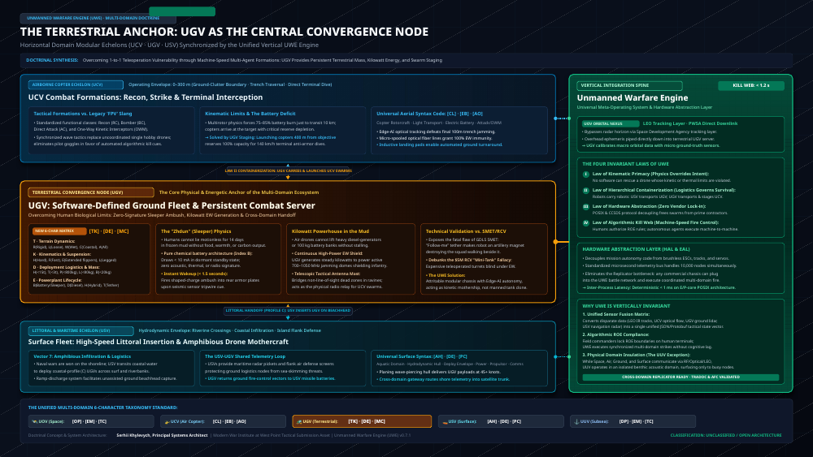

# SUBMISSION PACKAGE: MODERN WAR INSTITUTE AT WEST POINT (ANALYSIS & COMMENTARY)

### Editorial Submission Details

| Field | Detail |
| :--- | :--- |
| **Target Publication** | **Modern War Institute at West Point** (`mwi.westpoint.edu`) |
| **Publisher** | United States Military Academy (USMA), West Point, NY |
| **Section** | Tactical & Operational Analysis / Future Warfare & Human-Machine Integration |
| **Recipient Editors** | **John Amble**, Editor-in-Chief (`john.amble@westpoint.edu`) **Charlie Faint**, Managing Editor (`charles.faint@westpoint.edu`) **General Editorial Desk**: `MWIsubmissions@westpoint.edu` |
| **Submission Category** | Doctrinal Commentary & Technical Analysis (~2,150 words) |
| **Author** | **Serhii Khylevych**, Principal Systems Architect |
| **Author Profile** | [LinkedIn: Serhii Khylevych](https://www.linkedin.com/in/serhii-khylevych-aa152322/) |
| **Manuscript Title** | *The Autonomous Trench: Why 1-to-1 Teleoperation Fails in the Sensor-Rich Kill Zone and Demands an Unmanned Warfare Engine* |
| **Enclosed Assets** | Clean Word Manuscript (`.docx`), Publication Reference Layout (`.pdf`), Tactical Architecture Infographic (`mwi_ugv_ground_kill_zone_fitted.png`) |

---

## PART 1: THE EDITORIAL PITCH (Cover Query to MWI Editorial Desk)

**To:** `john.amble@westpoint.edu`, `charles.faint@westpoint.edu`, `MWIsubmissions@westpoint.edu`  
**Subject:** SUBMISSION: The Autonomous Trench — Why 1-to-1 Teleoperation Fails in the Sensor-Rich Kill Zone and Demands an Unmanned Warfare Engine

Dear John, Charlie, and the Modern War Institute Editorial Team,

The core thesis of *Strategy Strikes Back*—monolithic imperial platforms doomed by distributed asymmetric mass—is literally today's Ukraine kill zone. In that operational crucible, 1-to-1 UGV teleoperation has become just another Death Star exhaust port.

As the U.S. Army accelerates its Human-Machine Integration (HMI) experiments through Project Convergence and units rotate through "Transforming in Contact" deployments, land warfare doctrine stands at a dangerous conceptual impasse. We are continuing to field ground robotics under a flawed mental model: the assumption of **1-to-1 teleoperation**.

Whether evaluating the Squad Multipurpose Equipment Transport (SMET) or testing multi-million-dollar Robotic Combat Vehicles (RCV), current concepts assume a soldier in a fighting vehicle or trench can continuously pilot a remote ground machine via a dedicated radio link and a ruggedized tablet. Drawing on four years of direct frontline systems engineering under continuous electronic warfare and loitering munition bombardment in Ukraine, I can state unequivocally: **1-to-1 teleoperation is dead on arrival in a contested peer conflict.**

Under persistent electronic warfare and pervasive overhead optical surveillance, tethering an operator to a single remote chassis triggers immediate cognitive saturation, exposes the operator's RF signature to counter-battery strikes, and blinds the machine the moment line-of-sight is lost in ground clutter. 

I have completed an analytical essay (~2,150 words) structured specifically for the Modern War Institute's audience of military practitioners, TRADOC doctrine writers, and field-grade commanders:

**"The Autonomous Trench: Why 1-to-1 Teleoperation Fails in the Sensor-Rich Kill Zone and Demands an Unmanned Warfare Engine"**

Rather than offering generic critiques, the article establishes an objective **engineering and doctrinal validation framework** for existing and prospective Army programs (FM 3-0, AFC Pamphlet 71-20-9):

1. **The 85-Year Teleoperation Paradox:** Tracing the recurring collapse of remote-control combat from Soviet shortwave teletanks (1939) and the German *Goliath* demolition carrier to the $18 billion cancellation of Future Combat Systems (FCS MULE). 
2. **Biological Incompatibilities & Physical Superiority:** Demonstrating what unmanned ground systems (UGVs) must do that crewed platforms fundamentally cannot: eliminating the 15-cubic-meter living space penalty, executing multi-day dormant sleeper holds ("Zhdun" physics at zero thermal and acoustic signature), and providing persistent kilowatt-level power in the mud.
3. **The Connective Backbone (Cross-Domain Convergence):** Proving why UGV is not an isolated "single-mission cart," but the terrestrial convergence anchor binding Low Earth Orbit (UOV / PWSA Tracking Layer), airborne multirotor formations (UCVs), and littoral surface vessels (USVs) across the beachhead.
4. **Law II Containerization & Retiring Hobbyist Slang:** Explaining why multirotors cannot transit the contested zone on their own batteries and must be staged by armored UGVs at the tactical edge. Formally retiring consumer "FPV" slang and media buzzwords ("swarms") in favor of standardized military classifications: Unmanned Copter Vehicles (UCV) and synchronized combat formations.
5. **The Universal 6-Character UGV Matrix (`[TK]-[DE]-[MC]`):** Introducing a standardized cyber-physical taxonomy harmonized with USV, UOV, and UUV standards, allowing procurement officers to objectively validate chassis mobility, logistics footprints, energy architectures, and cross-domain gateways without vendor lock-in.

The complete manuscript is attached in Microsoft Word (`.docx`) and layout-verified PDF (`.pdf`), accompanied by a publication-grade 16:9 tactical architecture infographic illustrating the multi-echelon battle loop.

All concepts are based strictly on unclassified open-source operational physics, published U.S. Army doctrine, and open engineering standards.

Sincerely,

**Serhii Khylevych**  
Principal Systems Architect | Creator of the Unmanned Warfare Engine (UWE)  
[LinkedIn Profile](https://www.linkedin.com/in/serhii-khylevych-aa152322/)

---

## PART 2: THE ANALYTICAL MANUSCRIPT

# The Autonomous Trench: Why 1-to-1 Teleoperation Fails in the Sensor-Rich Kill Zone and Demands an Unmanned Warfare Engine

**By Serhii Khylevych**

---

### Technical & Operational Disclaimer

> **DISCLAIMER ON SOURCES AND OEM ENCODING VALIDATION:**  
> All operational models, taxonomies, kinetic formulas, and architectural frameworks presented herein are derived exclusively from unclassified open-source intelligence (OSINT), public military doctrine publications (including U.S. Army FM 3-0 *Operations* and AFC Pamphlet 71-20-9 *Human-Machine Integration*), and open international engineering standards (POSIX, CCSDS, OMG DDS). Specific vehicle classifications and alphanumeric codes cited as examples serve as illustrative architectural benchmarks. Formal operational adoption, baseline encoding, and deployment of these classifications require empirical validation and certification by original equipment manufacturers (OEMs) and military acquisition authorities against current certified technical performance specifications (TTX). This document contains no proprietary contractor data or ITAR/EAR-controlled information.

---

### The Teleoperation Paradox: An 85-Year Tactical Cul-de-Sac

Across the proving grounds of the National Training Center and during Project Convergence Capstone rotations, the visual spectacle of modern ground robotics is seductive: an infantry squad advances through a mock urban complex while an operator crouched behind cover steers an unmanned ground vehicle via a ruggedized touchscreen, suppressing a simulated bunker. To defense procurement boards, this vision represents the fulfillment of Army Futures Command’s Human-Machine Integration (HMI) concept.

To any engineer who has spent the past four years designing, patching, and fielding autonomous hardware under continuous peer bombardment in Ukraine, this vision is recognized for what it truly is: an operational illusion.

The concept of 1-to-1 teleoperation—one human operator remotely commanding one ground machine over a wireless data link—is not an emerging innovation; it is an eighty-five-year-old tactical cul-de-sac. In the winter of 1939, the Red Army deployed radio-controlled "teletanks" (TT-26 and TT-BT-7) into the Karelian Isthmus during the Winter War. Controlled via high-frequency transmitters from a trailing command tank, they were intended to clear Finnish defensive works without risking crew lives. The concept collapsed within days: shortwave signals degraded in rolling topography, boulders broke visual line-of-sight, and operators navigating through primitive periscopes repeatedly steered multi-ton machines into anti-tank ditches. Three years later, the German Wehrmacht encountered the identical physical reality with the *Goliath* (Sd.Kfz. 302/303) tracked demolition carrier; its wire-tethered control lines were consistently severed by artillery fragments, while its radio-directed successor, the *Borgward IV*, proved utterly helpless under basic line-of-sight obscuration.

When the Pentagon launched the Future Combat Systems (FCS) program in 2003, it committed over $18 billion attempting to solve this same problem through technological brute force. The Multifunction Utility/Logistics and Equipment (MULE) vehicle and the Armed Robotic Vehicle (ARV) were designed as monolithic, multi-million-dollar extensions of manned vehicles. They failed not because their code was deficient, but because they treated the robot as a teleoperated surrogate soldier rather than addressing the physical invariants of the ground domain.

Today, Western militaries are repeating this historical error. Current doctrine, including the baseline assumptions underpinning the Squad Multipurpose Equipment Transport (SMET) and the Robotic Combat Vehicle (RCV) programs, remains anchored to the "Centaur" model of human-machine teaming. In an environment dominated by high-power electronic warfare (EW) and pervasive overhead loitering munitions, 1-to-1 teleoperation fails for three unalterable physical reasons:

1. **RF Emission as a Kinetic Beacon:** Maintaining a high-definition video downlink requires sustained radio frequency (RF) transmission. In peer conflict, any omnidirectional RF emitter radiating above the noise floor is geolocated by automated signals intelligence (SIGINT) within 90 seconds, cueing precision tube artillery or loitering strikes onto the operator's dugout.
2. **Terrain-Induced Line-of-Sight Blackouts:** Unlike an aircraft operating in free air, a ground chassis operates inside the surface boundary layer. At standoffs exceeding 800 meters, micro-relief, dense tree lines, concrete rubble, and soil berms attenuate radio waves according to the fourth-power path loss law ($P_r \propto 1/R^4$). The operator loses control precisely when the vehicle enters the dead ground of the objective.
3. **Cognitive Saturation Under Fire:** Piloting a ground vehicle across dynamic, obstacle-strewn terrain demands 100 percent of an operator's spatial attention. An infantryman staring into a tablet cannot maintain local security, cannot communicate with adjacent fire teams, and cannot survive a combined-arms breach.

To break this cycle, the Army must stop treating the Unmanned Ground Vehicle (UGV) as a remote-controlled mechanical pack mule or a teleoperated mini-tank. The UGV must be re-engineered as the **terrestrial convergence anchor** of an integrated multi-domain ecosystem.

---

### Biological Incompatibility: What Machines Must Do That Soldiers Cannot

The primary rationale for unmanned systems is not merely risk reduction; it is operational capability. Manned fighting vehicles are severely constrained by human biology:

* **The Living Space Volume Penalty:** To sustain a crew of three or four soldiers, an infantry fighting vehicle (IFV) or main battle tank (MBT) must enclose twelve to eighteen cubic meters of internal air space. This volume demands life support systems, spall liners, blast-attenuating seats, ergonomic clearances, and escape hatches. Consequently, modern armored platforms weigh between 30 and 70 metric tons and stand 2.5 to 3.5 meters tall—rendering them impossible to conceal from multi-spectral airborne sensors. An autonomous chassis carries no air; its vertical profile can be reduced to 40 centimeters, allowing it to navigate below the geometric crest of standard trench parapets.
* **The "Zhdun" (Sleeper Hold) Physics:** Humans are thermodynamic beacons. A living soldier radiates 100 watts of thermal energy ($36.6^\circ\text{C}$), expels carbon dioxide and water vapor, makes noise, and requires daily sustenance and waste elimination. A soldier cannot remain motionless in frozen mud at $-10^\circ\text{C}$ for two weeks inside a contested gray zone. Conversely, an electric UGV built on chemical battery architecture can enter deep algorithmic standby. Drawing less than 10 milliamperes to maintain passive seismic and acoustic tripwire sensors, it presents zero thermal contrast, zero acoustic noise, and zero radio emissions. It can remain dormant in a shell crater for fifteen days, waking in under 1.5 seconds when an adversary mechanized column enters its engagement sector.
* **The Kilowatt Powerhouse in the Mud:** Airborne drones are governed by aerodynamic lift equations; every gram of battery or generator mass severely degrades flight endurance. A ground chassis, supported by the normal force of the earth, can easily bear heavy diesel-electric powerplants. A medium UGV generates steady kilowatts of electrical power, enabling continuous high-power electronic countermeasure (ECM) jamming domes (700–1050 MHz) to shield infantry formations and powering directional telescopic antennas that bridge RF dead zones.

---

### The Connective Backbone: UGV as Cross-Domain Convergence Node

The fundamental architectural error of modern defense procurement is domain siloization. Air programs procure drones; ground commands procure trucks; maritime forces procure patrol craft. In modern warfare, this functional segregation is fatal.

The Unmanned Ground Vehicle is the **connective tissue** of the entire battle network. Airborne systems and orbital constellations possess high vantage points but lack physical persistence. A Low Earth Orbit (LEO) satellite traverses the horizon in minutes; a fixed-wing reconnaissance UAV must orbit standoff orbits to survive air defenses; tactical multirotors exhaust their energy in half an hour. Only the UGV possesses **infinite terrestrial dwell time**. It does not burn kilowatt-hours overcoming gravity.

The UGV anchors three distinct cross-domain interfaces:

1. **Space Domain (UOV $\leftrightarrow$ UGV):** Through the Space Development Agency's Proliferated Warfighter Space Architecture (PWSA) Tracking Layer, Unmanned Orbital Vehicles (UOV) detect ballistic launches and vehicle thermal blooms from orbit. However, orbital sensors cannot determine whether a bunker entrance is obstructed or if anti-tank wire has been laid across a ditch. The UGV acts as a ground-level calibration node, ingesting LEO tracks and conducting micro-level sensory verification using ground lidar, thermal imagers, and seismic arrays.
2. **Maritime Domain (USV $\leftrightarrow$ UGV):** In littoral archipelagos and riverine warfare, the Unmanned Surface Vehicle (USV) dominates water corridors. Yet coastal operations are decided on the shore. Operating under the UWE Vector 7 profile (Amphibious Infiltration), USVs transport coastal-profile (`C`) UGVs across water obstacles, deploying them via bow ramps onto riverbanks and sandbars to establish anti-armor blocking positions and secure the landward flank. This capability transitioned from doctrine to history during Ukrainian operations demonstrating the world's first fully unmanned robotic amphibious landing, where an uncrewed naval surface vessel approached an enemy beachhead and deployed a machine-gun-armed ground combat robot directly into the assault (verified in field combat coverage by [NBC News / Matt Bradley](https://www.facebook.com/reel/914730374404774)).
3. **Air Domain (UGV $\leftrightarrow$ UCV):** The UGV solves the most pressing bottleneck in modern tactical aviation: the battery deficit of combat multirotors.

---

### The Kinetic Engine: UGV and UCV Combat Formations

In current discourse, the term "FPV" is used indiscriminately to describe everything from modified racing drones to loitering munitions. This consumer hobbyist slang must be retired. Military doctrine requires precise engineering taxonomy: **Unmanned Copter Vehicles (UCV)**, categorized by mission payload: Reconnaissance (`RC`), Bomber (`BC`), Direct Attack (`AC`), and One-Way Mission (`OWM`) kinetic interceptors.

Similarly, media buzzwords such as "swarm" obscure tactical reality. Professional military forces do not deploy unstructured swarms; they employ **combat formations**—synchronized echelons executing mutual support, screening, and breach maneuvers.

Under **Law II of the Unmanned Warfare Engine (The Law of Hierarchical Containerization)**, smaller autonomous agents must be transported by larger carriers to preserve energy for the kinetic engagement. A tactical multirotor consumes 75 to 85 percent of its total battery capacity merely transiting five to eight kilometers against head-winds across a contested front line. When it reaches an enemy defensive position, its battery is depleted, leaving zero endurance to locate concealed targets or execute evasive maneuvers against trench jammers.

The UGV resolves this kinematic crisis. Acting as an **armored tactical carrier and staging node**, a medium UGV transports internal climate-controlled launch cassettes carrying eight to sixteen UCVs. Moving through tree lines under darkness or rolling terrain, the UGV positions itself 300 to 500 meters from the objective. Upon command, it launches a coordinated combat formation directly into the objective area. The UCVs arrive over the target with 100 percent battery reserves, capable of executing terminal dives at 140 kilometers per hour. For persistent reconnaissance, the UGV provides inductive roof-mounted recharging pads and micro-spooled optical fiber tethers, enabling uninterrupted overwatch immune to radio frequency jamming.

---

### Figure 1: Tactical Architecture Breakdown

The accompanying tactical diagram (Figure 1) formalizes the multi-domain relationship between these horizontal operating layers and the unifying software backbone.

*Figure 1: Cross-Domain Tactical Synchronization: UCV (Airborne Echelon), UGV (Terrestrial Anchor), and USV (Littoral Echelon) unified through the vertical Unmanned Warfare Engine (UWE) software backbone.*

As depicted in Figure 1, the architecture is organized into three horizontal domain modules and a single vertical integration spine:

* **Top Module (Airborne UCV Echelon):** Illustrates the 0–300 meter low-altitude combat envelope where UCV formations operate. By offloading long-range transit to ground carriers, multirotors optimize for high-speed terminal guidance, optical-flow tracking, and fiber-optic command links.
* **Central Module (Terrestrial UGV Anchor):** Highlights the core physical role of the UGV. It houses the 6-character classification standard, operational capabilities for dormant sleeper ambushes, kilowatt-scale power generation, and objective validation criteria that distinguish it from legacy teleoperated carts.
* **Bottom Module (Littoral USV Echelon):** Displays the amphibious interface at the water line, showing how high-speed surface craft insert coastal-profile UGVs to link littoral fires with inland ground maneuvers.
* **Vertical UWE Integration Spine:** The continuous column spanning the right flank represents the Unmanned Warfare Engine. It establishes the Hardware Abstraction Layer (HAL) and Enterprise Abstraction Layer (EAL) on open POSIX and CCSDS protocols, delivering sub-millisecond inter-process latency and an end-to-end multi-domain kill web latency under 1.2 seconds.

---

### Technical Validation: The Universal 6-Character UGV Matrix

To enable Army Futures Command and TRADOC doctrine writers to evaluate ground robotic platforms without relying on vendor marketing, the Unmanned Warfare Engine introduces the **Universal 6-Character UGV Taxonomy: `[TK]-[DE]-[MC]`**.

Mirrored across the UOV (`[OP]-[EM]-[TC]`), USV (`[AH]-[DE]-[PC]`), and UUV (`[DP]-[EM]-[TC]`) standards, each character defines a single objective engineering parameter:

$$\mathbf{[TK]} \quad-\quad \mathbf{[DE]} \quad-\quad \mathbf{[MC]}$$

#### 1. Terrain Dynamics (`T`)
* **`R` (Rigid):** Solid rock, fractured concrete, urban rubble, paved surfaces.
* **`L` (Loose):** Dry sand, gravel scree, uncompacted soil, slag heaps.
* **`W` (Wet):** Saturated clay, peat bogs, marshland, standing water ($\le 0.8\text{ m}$).
* **`M` (Mixed-Dry):** Cross-over profile ($R + L$) resistant to track-shedding on shattered brick.
* **`C` (Coastal):** Littoral cross-over profile ($L + W$) for surf zones and mudbanks—**the amphibious link to USV**.
* **`A` (All-Terrain):** Universal combat mobility ($80\text{ km/h}$ Rigid, $40\text{ km/h}$ Loose, $20\text{ km/h}$ Wet).

#### 2. Kinematics & Suspension (`K`)
* **`H` (Hard):** Heavy-duty unsprung or rigid suspension for armored shock resistance.
* **`F` (Fast):** Independent damped suspension for high-speed cross-country stability.
* **`E` (Extended):** Articulated climbing flippers for vertical step and trench obstacle traversal.
* **`S` (Semi-Adaptive):** Variable ground clearance for static belly-down concealment ("Zhdun" mode).
* **`A` (Adaptive):** Active multi-jointed kinematics that morph geometry during locomotion.
* **`L` (Legged):** Quadruped or biped biomimetic articulated limbs for subterranean and trench networks.

#### 3. Carrier Deployment & Mass Envelope (`D`)
* **`H` (Heavy):** Up to $15\,000\text{ kg}$ (transported via heavy equipment trailers).
* **`T` (Truck):** Up to $3\,000\text{ kg}$ (standard tactical cargo truck or IFV bay).
* **`P` (Pickup):** Up to $800\text{ kg}$ (flatbed pickup truck or tactical trailer).
* **`L` (Light):** Up to $80\text{ kg}$ (ATVs, buggies, or armored vehicle exterior racks).
* **`B` (Backpack):** Up to $20\text{ kg}$ (individual infantry rucksack module).
* **`U` (Utility):** Up to $5\text{ kg}$ (vest-carried micro-reconnaissance rovers).

#### 4. Powerplant Lifecycle & Energy (`E`)
* **`B` (Battery):** Pure chemical electric storage (Li-Ion/LiFePO4). Baseline for zero-emission sleeper holds.
* **`D` (Diesel):** Compression-ignition heavy fuel engine. NATO fuel interoperability and extreme torque.
* **`G` (Gasoline):** High-RPM spark ignition for high power-to-weight field generators.
* **`H` (Hybrid):** Combustion generator combined with buffer traction batteries for silent sprint capability.
* **`T` (Tethered):** Micro-wire continuous external electrical feed for indefinite static defense.

#### 5. Mission Mode & Combat Payload (`M`)
* **`K` (Kinetic Strike):** Remote weapon station (RWS), anti-tank guided missiles, or breaching demolition charge.
* **`C` (Carrier Mothership):** Internal launch bays and inductive charging pads for UCV combat formations.
* **`L` (Logistics & CASEVAC):** Armored casualty evacuation pod and automated ammunition pallet conveyance.
* **`E` (Engineering):** Mine-clearing rollers, line-charge launchers (MICLIC), and obstacle clearance plows.
* **`W` (Electronic Warfare):** High-power localized RF jamming dome and counter-UAS emitter array.
* **`S` (Surveillance & Acquisition):** Telescopic multispectral mast, ground lidar, seismic sensors, and laser designators.

#### 6. Cross-Domain Gateway & Control (`C`)
* **`S` (Space Uplink):** Direct LEO satellite transceiver (PWSA / Starlink) with automated orbital downlinks.
* **`M` (Tactical MESH Relay):** Ad-hoc multi-hop broadband RF node providing persistent air-ground relay.
* **`O` (Optical / Fiber Tether):** Spooled fiber-optic cable granting 100 percent immunity to electromagnetic jamming.
* **`A` (Autonomous Edge-AI):** Full radio silence; onboard inertial dead reckoning and visual SLAM navigation.
* **`G` (Cross-Domain Gateway):** Integrated router synchronizing telemetry across USV, UCV, and UOV networks.

---

### Auditing Legacy Programs

Through this 6-character baseline, Army leadership can objectively evaluate why programs like SMET encounter severe tactical friction:

1. **The SMET Failure Mode:** Classified under legacy thinking as a generic "equipment mule," SMET operates primarily in a tethered or "follow-me" mode behind dismounted soldiers. In the 6-character syntax, a system that lacks an armored kinetic payload (`M`) or an autonomous standoff profile (`C`) becomes a liability. A $1,500\text{ kg}$ vehicle trailing thirty meters behind an infantry squad acts as a visual and thermal target indicator, drawing artillery and loitering strikes onto the very soldiers it was intended to unburden.
2. **The RCV Dilemma:** Experimental Robotic Combat Vehicles, designed around traditional turreted weapons mounted on miniaturized tracked hulls, attempt to replicate manned armor. At $3 to $5 million per unit, commanders treat them with the same risk aversion as crewed vehicles. Under UWE doctrine, ground mass must be **attritable and software-defined**. Rather than mounting an expensive electro-optical turret that blinds under dust and shrapnel, the chassis serves as a launch platform (`C`) for expendable copters and a high-power energy donor (`E`), distributing combat effects across multiple distributed nodes.

---

### Conclusion: Transforming in Contact with Machine-Speed Mass

In *FM 3-0 Operations*, the U.S. Army emphasizes that victory in Multi-Domain Operations depends on creating multiple dilemmas for an adversary faster than they can react. Yet, so long as ground robotics remain tethered to the cognitive bandwidth and survival instincts of individual human teleoperators, our tactical tempo remains bounded by human neurological limits.

The war in Ukraine has demonstrated that the sensor-rich kill zone is an unforgiving filter. Machines piloted through consumer goggles and individual joysticks cannot achieve massed, synchronized breakthroughs against integrated defenses. The path forward does not require abandoning our field manuals; it requires anchoring our doctrine in physical reality.

By transitioning from 1-to-1 teleoperated gizmos to the **Unmanned Warfare Engine architecture**, the Army can field ground systems that leverage their true physical advantages: infinite terrestrial dwell time, biological immunity, kilowatt energy generation, and the ability to stage massed air and surface formations directly at the point of friction. The autonomous trench is not a futuristic concept; it is an immediate physical imperative.

---

### Author Biography

**Serhii Khylevych** is a Principal Systems Architect specializing in autonomous multi-domain combat ecosystems, cyber-physical architectures, and real-time telemetry protocols. Over four years of frontline engineering integration under active bombardment in Ukraine, he has architected open software frameworks and standardized classifications spanning orbital, aerial, terrestrial, and maritime unmanned vehicles. He is the creator of the Unmanned Warfare Engine (UWE).
