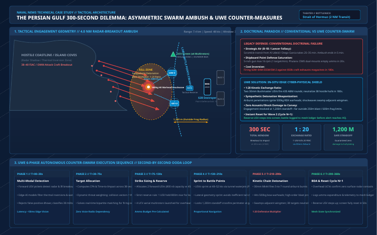
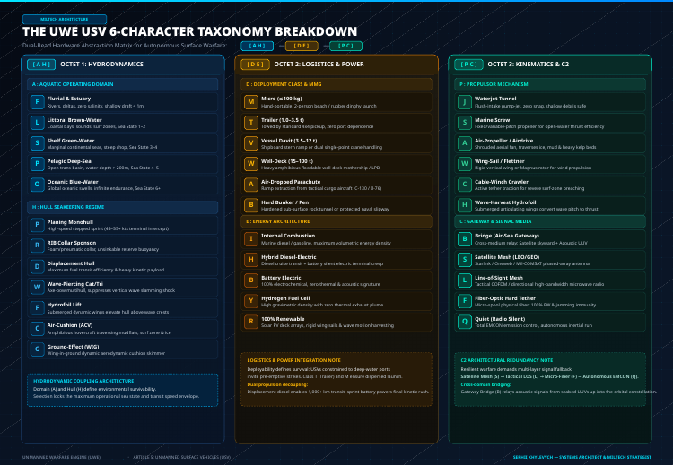

# The Software-Defined Surface Fleet: Black Sea Lessons & The Persian Gulf Swarm Dilemma

**Naval News // In-Depth Technical Feature & Op-Ed**  
**Author:** Serhii Khylevych, Principal Systems Architect  
**Operational Scope:** Unmanned Surface Warfare (USV), Littoral Counter-Swarm, Edge Cyber-Physical Orchestration  

---

## Executive Pitch & Context

The conflict in the Black Sea has irrevocably dismantled the twentieth-century paradigm of capital ship invulnerability in littoral waters. Commercial-off-the-shelf hull manufacturing, low-profile hydrodynamics, and expendable one-way attack craft have paralyzed a conventional battle fleet, imposing maritime sea denial without a standing navy. 

Yet, as naval planners in Washington, London, and allied capitals seek to translate these lessons to the Indo-Pacific and the Middle East, a dangerous doctrinal fallacy is emerging: the belief that drone warfare can be scaled simply by mass-procuring disjointed, radio-controlled strike craft. 

True naval scalability requires treating unmanned craft not as isolated remote-control weapons, but as software-defined, cyber-physical nodes operating within an open architectural standard. This analysis examines how the **Unmanned Warfare Engine (UWE)** architecture solves the ultimate littoral nightmare—**the 300-second saturation swarm ambush in the Strait of Hormuz**—and presents a universal **Six-Letter Taxonomy** to standardize the emerging autonomous surface fleet.

---

## Technical & Operational Disclaimer

> **DISCLAIMER ON SOURCES AND OEM ENCODING VALIDATION:**  
> All operational models, taxonomies, kinetic formulas, and architectural frameworks presented herein are derived exclusively from unclassified open-source intelligence (OSINT), published naval doctrine (including Wayne Hughes’ Salvo Equations), and open international engineering standards (POSIX, OMG DDS). Specific vehicle classifications and alphanumeric codes cited as examples serve as illustrative architectural benchmarks. Formal operational adoption, baseline encoding, and deployment of these classifications require empirical validation and certification by original equipment manufacturers (OEMs) and naval acquisition authorities against current certified technical performance specifications (TTX). This document contains no proprietary contractor data or ITAR/EAR-controlled information.

---

## 1. The Littoral Saturation Crisis: The B-1B Fallacy and Point-Defense Exhaustion

Western naval doctrine currently faces a catastrophic temporal mismatch in contested littoral choke points (the Strait of Hormuz, Bab-el-Mandeb, and the Taiwan Strait). When an adversary deploys a dense, multi-axis swarm of fast inshore attack craft (FIAC) and low-profile explosive unmanned surface vessels (OWMs), conventional defense architectures collapse under three structural failures:

1. **The Strategic Aviation Illusion (The B-1B Fallacy):**  
   In Pentagon wargames and maritime interdiction trials, heavy strategic bombers deploying sensor-fuzed submunitions (e.g., CBU-105/BLU-108) successfully neutralized boat swarms in high density. However, this model assumes strategic aviation is already on station directly overhead. If alert aircraft must scramble from regional hubs (e.g., Al Udeid in Qatar or Diego Garcia), transit time alone exceeds **25 to 35 minutes**. In a littoral ambush originating four nautical miles from shipping lanes, the entire tactical engagement is resolved within **300 seconds (5 minutes)**. Air support arrives half an hour after the surface group has been crippled.

2. **Point-Defense Channel Saturation:**  
   A modern guided-missile destroyer (DDG-51 *Arleigh Burke* class) possesses unparalleled deep-ocean air-defense capabilities, but its close-in weapon channels are rapidly exhausted by multi-axis surface saturation. A single 5-inch/62 caliber Mk 45 gun (firing at a maximum cyclic rate of 16–20 rounds per minute) can engage only one to two maneuvering surface targets per minute. Shipboard 20mm Phalanx Block 1B CIWS mounts feature single-target tracking channels with ammunition drums that empty in approximately 20 seconds of continuous fire. 

3. **Asymmetric Cost and Magazine Inversion:**  
   Expending $2M to $4M surface-to-air missiles (ESSM or SM-2) against $50,000 fiberglass drone boats traveling at 45 knots in heavy sea clutter is economically unsustainable and rapidly exhausts vertical launch system (VLS) cells needed for fleet air defense. Crew-served .50-caliber heavy machine guns on rolling decks are incapable of countering coordinated, multi-directional attacks in high heat haze and night conditions.

---

## 2. Operational Case Study: The Persian Gulf 300-Second Dilemma

To demonstrate how a software-defined architecture resolves this saturation crisis, consider the tactical crucible of the **Strait of Hormuz**: an allied high-value task force transiting a narrow two-nautical-mile international shipping channel ambushed by **40 hostile fast attack craft and explosive USVs** emerging from radar-shadowed island coves at 48 knots ($25\text{ m/s}$).

At a breakout range of 4.0 nautical miles ($7.4\text{ km}$), the remaining time before the first explosive contact on the destroyer's hull is precisely **280 to 320 seconds**. 

### The UWE In-Situ Autonomous Counter-Swarm Execution

Under UWE doctrine, the surface group does not rely on off-board air support or shipboard manual mounts. Instead, the task force deploys an autonomous forward screen of counter-swarm USVs (`SV-RI-JS` interceptors armed with 30mm Bushmaster Mk44 / XM914 chain guns firing Airburst Munitions — ABM). 

The engagement is resolved through a six-phase algorithmic combat loop executed strictly within the 300-second window:

* **Phase 1: Distributed Multi-Modal Detection & Edge Classification ($T+00\text{s} \to T+30\text{s}$):**  
  Forward-deployed USV pickets detect radar cross-section (RCS) surges and infrared breakout signatures. Onboard Edge-AI vision pipelines (60 FPS MWIR/EO) instantly reject Persian Gulf thermal inversions, sun glint, and civilian dhows, classifying 38 to 40 military hulls with a processing latency under 50 milliseconds.
* **Phase 2: Target Allocation & Bipartite Kinematic Matching ($T+30\text{s} \to T+75\text{s}$):**  
  The distributed orchestration engine computes Closest Point of Approach (CPA) and Time-to-Impact across all 40 vectors. Target weights are assigned: direct head-on collision vectors are prioritized ($W_{max}$). The system solves a real-time bipartite matching problem, assigning firing sectors without requiring human operator intervention over voice radio.
* **Phase 3: Force Sizing & Echeloned Reserve Formation ($T+75\text{s} \to T+130\text{s}$):**  
  Applying a verified 1:20 kinetic exchange ratio, the system allocates two forward interceptor USVs (totaling 800 rounds of 30mm ABM) to engage the primary wave. A mandatory reserve echelon—one reserve USV positioned 800 meters astern and four vertical-takeoff unmanned aerial craft (UCVs) at 300 meters altitude—is held to intercept breakout vectors.
* **Phase 4: Sprint to Geometric "Battle Points" ($T+130\text{s} \to T+210\text{s}$):**  
  Rather than attempting an inefficient stern chase, interceptor USVs sprint laterally at 48–52 knots using tunnel waterjets (`P: J`) along Proportional Navigation trajectories. They lock into pre-calculated **"Battle Points"** establishing an interlocking cross-fire perimeter at **1,200 meters standoff distance** from the friendly convoy.
* **Phase 5: Kinetic Standoff & Sympathetic Chain Detonation ($T+210\text{s} \to T+290\text{s}$):**  
  Slaved to optronic tracking directors, 30mm chain guns deliver 5-to-7-round airburst bursts aimed at the unarmored bow sections of incoming craft where 500 kg high-explosive warheads reside. Precision airburst penetration triggers high-order sympathetic detonation of the warhead. Because boat swarms cluster in dense wedges for mutual protection, the violent shockwave ($V_{det} \approx 8,000\text{ m/s}$) and localized water cavity instantly swamp, capsize, or sympathetically detonate neighboring craft. Two USVs neutralize 32 hulls; the reserve and overhead UCVs eliminate the remaining six.
* **Phase 6: Automated BDA & Instant Reset for Wave 2 ($T+290\text{s} \to T+360\text{s}$):**  
  Overhead UCVs confirm the zeroing of all surface radar tracks. Ammunition expenditure (435 rounds total) and platform telemetries are committed to a local cryptographic mesh ledger. The reserve USV steps into the frontline perimeter, resetting the defensive screen for Cycle $N+1$ in under 50 seconds—**long before a traditional naval operations room could finalize an emergency voice alert to fleet headquarters.**

---

## 3. Standardizing the Mosquito Fleet: The 6-Letter USV Taxonomy

A primary bottleneck hindering multinational USV interoperability is the lack of a standardized classification language. Naval procurement programs currently describe surface drones using ambiguous marketing labels ("small," "medium," "attritable," "kamikaze"). 

UWE introduces a universal **Six-Letter Architectural Taxonomy** ($[\mathbf{A}\mathbf{H}] - [\mathbf{D}\mathbf{E}] - [\mathbf{P}\mathbf{C}]$), standardizing hydrodynamic envelopes, logistics footprints, and kinetic missions into a single NATO-compatible descriptor:

$$\mathbf{USV} = [\mathbf{Domain} \cdot \mathbf{Hydrodynamics}] - [\mathbf{Propulsion} \cdot \mathbf{Mission}] - [\mathbf{Autonomy} \cdot \mathbf{Control}]$$

### The Six Vectors of the Classification Framework

| Pos | Vector | Code & Description | Operational Definition & Environmental Context |
| :---: | :--- | :--- | :--- |
| **1** | **Operational Domain** | `R` — Riverine `L` — Littoral `S` — Shelf `O` — Oceanic | • `R`: Inland waterways, draft $< 0.8\text{ m}$, debris tolerance. • `L`: Inshore/coastal ($< 20\text{ NM}$), surf-zone navigation, shoals. • `S`: Marginal shelf seas (Black Sea, Persian Gulf), Sea State 3–4. • `O`: Open ocean, Sea State 5+, survivability in heavy swell. |
| **2** | **Hydrodynamic Envelope** | `M` — Monohull `K` — Catamaran `T` — Trimaran `H` — Hydrofoil `S` — SWATH `V` — Planing Deep-V | • `M`/`V`: High-speed sprint, low-RCS planing wedge. • `K`/`T`: Stable wide-beam sensor and weapon firing platform. • `H`: Dynamic lift, extreme speed ($> 55\text{ kts}$) with low drag. • `S`: Small Waterplane Area Twin Hull; minimal wave motion at low speeds. |
| **3** | **Propulsion & Power** | `D` — Marine Diesel `G` — Gasoline ICE `B` — Battery-Electric `H` — Hybrid Diesel-Elec `J` — Waterjet Direct-Drive | • `D`: High continuous endurance, heavy commercial fuel compatibility. • `G`: Ultra-lightweight, high power-to-weight for expendable craft. • `B`: Acoustic silence, zero thermal signature, covert insertion. • `J`: High maneuverability in shallow, weed-choked waters. |
| **4** | **Tactical Mission Payload** | `I` — ISR & Electronic War. `K` — Kinetic Strike / OWM `C` — Counter-Swarm Gun `M` — Minelaying / Minehunt `L` — Logistics / Fuel Picket | • `I`: Passive ESM arrays, thermal cameras, radar pickets. • `K`: Internal 250–500 kg shaped-charge warhead with bow contact fuze. • `C`: Stabilized 30mm/XM914 chain gun with airburst munitions. • `M`: Autonomous mine dispensers or towed sonar arrays. |
| **5** | **Autonomy Architecture** | `0` — Direct Remote Link `1` — Waypoint Auto-Transit `2` — Edge Obstacle Avoid. `3` — Swarm Collaborative | • `Level 0`: Manual teleoperation via low-latency SATCOM/mesh. • `Level 1`: GNSS route following with manual intervention. • `Level 2`: COLREGS-compliant autonomous navigation under EW. • `Level 3`: Decentralized cooperative swarm behavior without central C2. |
| **6** | **C2 & Communication** | `S` — SATCOM Dedicated `M` — Dynamic RF Mesh `C` — Cellular (LTE/5G) `O` — Optical / Free-Space | • `S`: Global beyond-line-of-sight reach; vulnerable to uplink jamming. • `M`: Resilient ad-hoc tactical network, peer-to-peer relay. • `C`: Exploitation of coastal civilian telecommunications towers. • `O`: Covert laser/directional optical link, immune to RF jamming. |

### Architectural Example: Deconstructing Tactical Craft

* **`SV-RI-JS` (Counter-Swarm Interceptor):**  
  *Shelf* operational domain (`S`), *Planing Deep-V* hull (`V`), *Waterjet* propulsion (`J`), *Counter-Swarm* 30mm weapon system (`C`), *Edge Obstacle Avoidance / Autonomous Intercept* (`2`), operating via *RF Mesh / Satellite* fallback.
* **`LM-GK-3M` (Black Sea Strike Craft):**  
  *Littoral* domain (`L`), low-RCS *Monohull* (`M`), *Gasoline* ICE (`G`), *Kinetic Strike* warhead (`K`), *Decentralized Collaborative Swarm* logic (`3`), linked via *High-Density Tactical Mesh* (`M`).

---

## 4. Edge Cyber-Physical Orchestration: Beyond Scripted Waypoints

The true dividing line between toy prototypes and war-winning maritime autonomy lies in the software stack. Legacy USV programs frequently suffer from "vendor lock-in," where platform control software is tightly coupled to proprietary hardware controllers, preventing third-party algorithm insertion.

UWE enforces a **Hardware Abstraction Layer (HAL)** decoupled via containerized POSIX microservices and an OMG DDS databus. This architecture provides three critical combat capabilities:

1. **Deterministic Latency for Dynamic Weapon Slew:**  
   Wave-motion prediction algorithms run directly on edge compute nodes (e.g., dual NVIDIA Jetson AGX Orin modules), computing roll, pitch, and yaw corrections at 1,000 Hz. Gun mounts receive fire-control solutions within 2 milliseconds, maintaining continuous point-of-aim against agile surface targets in Sea State 4 conditions.
2. **Autonomous Degradation Modes:**  
   When hostile electronic warfare severs satellite uplinks, UWE nodes automatically transition from cloud orchestration to local mesh consensus. If RF jamming cuts mesh links entirely, each craft executes pre-loaded autonomous interception rules based solely on passive onboard optical and radar signatures, preventing platform deadlocks.
3. **Dynamic Resource Re-allocation:**  
   If one USV experiences an engine failure or weapon jam during an engagement, the distributed task-allocation algorithm re-assigns its targets to neighboring vessels in real time without human intervention, maintaining 100% defense screen integrity.

---

## 5. Series Roadmap: Forthcoming Articles in Naval News

This technical feature represents **Part 1** of a three-part editorial series on the realization of the software-defined surface fleet. Forthcoming articles will explore:

* **Part 2: Seabed Warfare & Subsea Denial — Extending the UWE Architecture to Autonomous UUV Flotillas.**  
  *Focus:* Deep-water infrastructure protection, autonomous seabed acoustic listening pickets, and the mechanics of surface-to-subsurface cross-domain swarm handoffs in marginal shelf seas.
* **Part 3: Swarming Through Jamming — Dynamic Spectrum Agility, Cognitive EW, and Mesh Resilience.**  
  *Focus:* Overcoming high-density electromagnetic interference in contested maritime theaters. Architectural design of directional laser links, low-probability-of-intercept (LPI) frequency-hopping mesh radios, and decentralized consensus algorithms under total electronic isolation.

---

### Author Profile
**Serhii Khylevych** is an internationally recognized Principal Systems Architect specializing in autonomous cyber-physical systems, distributed edge architectures, and unmanned maritime surface warfare. He has led the architectural engineering of complex robotic platforms and tactical software systems for over a decade. Connect with the author via [LinkedIn](https://www.linkedin.com) or contact the *Naval News* editorial desk.
