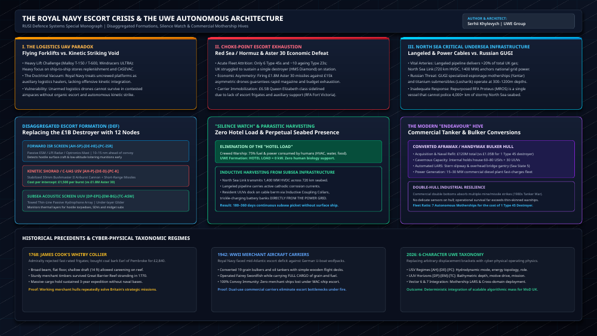

# The Software-Defined Escort: Why Distributed Autonomous Formations and Converted Commercial Hulls Must Solve the Royal Navy's Presence and Seabed Crises

### An Operational Architecture for the Unmanned Warfare Engine (UWE)
**Author:** Serhii Khylevych  
*Principal Systems Architect & Autonomous Defense Systems Integrator*  
**Affiliation:** Unmanned Warfare Engine (UWE) Architectural Group  
**Target Publication:** *RUSI Defence Systems* (Royal United Services Institute, Whitehall, London)  
**Date:** October 2026  

---

## PART 1: EDITORIAL COVER NOTE & SUBMISSION PITCH

**To:** The Editor, *RUSI Defence Systems*  
**From:** Serhii Khylevych, Principal Systems Architect  
**Subject:** MANUSCRIPT SUBMISSION: *The Software-Defined Escort: Why Distributed Autonomous Formations and Converted Commercial Hulls Must Solve the Royal Navy's Presence and Seabed Crises*  

Dear Editorial Board,

The Royal Navy and the Ministry of Defence (MoD) stand at an existential crossroads. As highlighted by the protracted crisis across the Red Sea, the Bab el-Mandeb, and the Strait of Hormuz, the United Kingdom’s surface combatant fleet is grappling with an acute presence deficit. Sustaining a single Type 45 guided-missile destroyer on continuous air-defence patrol stretches naval availability to its breaking point, while expending £1.5–2.0 million Aster 30 interceptors against £10,000 asymmetric aerial and surface threats represents an unsustainable economic attrition trajectory. Concurrently, beneath the waves of the North and Norwegian Seas, the UK’s vital energy arteries—most notably the *Langeled* gas pipeline providing over 20% of national supply, alongside subsea HVDC interconnectors such as *North Sea Link*—remain acutely exposed to deep-sea sabotage by specialist Russian underwater assets, a challenge far too vast for a single repurposed commercial support vessel like *RFA Proteus* to counter.

While the Royal Navy has aggressively tested rotary-wing uncrewed aerial systems (such as the Malloy T-150/T-600 under the Heavy Lift Challenge) to automate intra-theatre logistics, stores replenishment, and casualty evacuation, British naval innovation has developed a profound defensive and logistics fixation. The service is engineering autonomous flying forklifts and air ambulances, while adversaries deploy distributed kinetic strike networks.

This monograph presents a cyber-physical alternative derived from four years of high-intensity operational engineering and doctrine in the Black Sea littoral: the **Unmanned Warfare Engine (UWE)**. 

Drawing upon Britain’s own defining maritime history—specifically the Admiralty’s decision in 1768 to bypass delicate, rated warships and equip Lieutenant James Cook with a sturdy Whitby coal bark (*HMS Endeavour*), as well as the Merchant Aircraft Carriers (MAC-ships) of the Second World War—this paper proposes a twofold operational model:
1. **Functional Disaggregation of the Escort:** Replacing vulnerable, billion-pound capital destroyers with coordinated, multi-domain autonomous formations of Unmanned Surface Vehicles (USVs) and Unmanned Undersea Vehicles (UUVs). By eliminating crew-support requirements ("Hotel Load"), these platforms operate in a persistent, low-power **"Silence Watch"** regime, recharging via natural kinetic energy and **inductive parasitic harvesting directly from the subsea power interconnectors and cathodic pipelines they protect**.
2. **The Autonomous Fleet Hive:** Converting decommissioned commercial double-hull tankers and bulkers into resilient, low-cost **Medium and Heavy Autonomous Mothership Carriers**, capable of deploying 50–100 autonomous combat platforms without tying down frontline combatants or relying on vulnerable port facilities.

I submit this work for publication in *RUSI Defence Systems* to provide Whitehall planners, the Naval Staff, and NATO maritime strategists with an actionable, hardware-validated doctrine for twenty-first-century sea denial and infrastructure resilience.

Respectfully submitted,  
**Serhii Khylevych**  
*Principal Systems Architect*  

---

## PART 2: ANALYTICAL MONOGRAPH

```
┌─────────────────────────────────────────────────────────────────────────────┐
│                 THE UWE STRATEGIC DISPLACEMENT ARCHITECTURE                 │
├─────────────────────────────────────────────────────────────────────────────┤
│  LEGACY CAPITAL PARADIGM                   UWE DISTRIBUTED DOCTRINE         │
│  • Single Type 45 Destroyer (£1.05B)       • Autonomous Formation (15 Nodes)│
│  • 8,500-tonne Radar & Acoustic Target     • Ultra-low RCS (<0.75m board)   │
│  • Single Point of Failure                 • Graceful Degradation           │
│  • 190 Crew "Hotel Load" (75% power/vol)   • Zero Life-Support Demand       │
│  • Continuous Turbine Fuel Burn            • "Silence Watch" (Wave/Induct.) │
│  • £2M Aster 30 vs £15k Threats            • Directed Gun/SHORAD Intercept  │
│  • Tied to Fixed Naval Dockyards           • Commercial Mothership Hives    │
└─────────────────────────────────────────────────────────────────────────────┘
```

---

### 1. The British Naval Paradox: Logistic UAVs and the Kinetic Void

Over the past three years, the Royal Navy has positioned itself as an enthusiastic pioneer of naval uncrewed aviation. Through initiatives like the **Heavy Lift Challenge (HLC)**, Project Vampire, and autonomous trials aboard *HMS Prince of Wales* and Royal Fleet Auxiliary (RFA) vessels, the service has demonstrated impressive intra-theatre logistics capabilities. Rotary-wing quadcopters, prominently the **Malloy Aeronautics T-150 and T-600** (recently acquired by BAE Systems) alongside platforms like the **Windracers ULTRA**, have successfully transported stores, ammunition containers, and simulated casualty evacuation (CASEVAC) stretchers between ships and shore facilities.

Yet, this emphasis exposes a profound doctrinal imbalance within British naval thinking. Uncrewed systems are overwhelmingly treated as **auxiliary logistics enablers**—flying forklifts and air ambulances—designed to sustain a shrinking, legacy force of heavily crewed, multi-billion-pound combatants. 

While British procurement evaluates whether a heavy-lift drone can lift two mortar rounds or blood plasma across a 15-mile transit, adversaries and allied littoral combatants have spent the same period operationalising autonomous platforms as **distributed, massed kinetic striking instruments**. In the Black Sea, asymmetric uncrewed surface platforms eliminated over a third of a major power's surface combat fleet without the deployment of a single conventional frigate. In the Red Sea and the Gulf of Aden, non-state actors shut down one of the world's primary commercial choke points using cheap, mass-produced aerial loitering munitions and surface attack craft.

The Royal Navy's current trajectory risks producing an autonomous logistical apparatus in support of a combat fleet that cannot survive long enough in contested waters to consume those supplies. What the service urgently requires is not merely more efficient ways to transfer spare parts between hulls, but a fundamental transition toward **autonomous, software-defined kinetic presence**.

---

### 2. The Choke-Point Dilemma: Escort Exhaustion and Magazine Economics

The operational realities of the Red Sea and the Strait of Hormuz have laid bare the structural brittleness of the Royal Navy's surface combatant force structure.

```
┌─────────────────────────────────────────────────────────────────────────────┐
│                   THE FINANCIAL & MAGAZINE ASYMMETRY                        │
├─────────────────────────────────────────────────────────────────────────────┤
│  INTERCEPT COST COMPARISON:                                                 │
│                                                                             │
│  [Adversary Drone]   Cost: ~£10,000–£20,000                                 │
│         │                                                                   │
│         ▼                                                                   │
│  [Type 45 Sea Viper] Interceptor: Aster 30 Missile (~£1,800,000)            │
│                      Cost Exchange Ratio: 1:90 to 1:180                     │
│                      Magazine Depth: 48 Sylver VLS Cells Total              │
│                                                                             │
│  [UWE Kinetic USV]   Interceptor: 30mm Programmable Airburst (~£1,500/burst)│
│                      Cost Exchange Ratio: 10:1 in Defender's Favour         │
│                      Magazine Depth: Continuous Drum Re-feed                │
└─────────────────────────────────────────────────────────────────────────────┘
```

When international shipping came under sustained attack in the southern Red Sea and Bab el-Mandeb in 2023–2024, the United Kingdom could muster only a single frontline air-defence destroyer, **HMS *Diamond*** (Type 45), later relieved on an emergency rotational basis by ageing Type 23 frigates (**HMS *Richmond*** and **HMS *Lancaster***). 

This deployment highlighted three systemic vulnerabilities:
1. **The Escort Availability Trap:** The Royal Navy possesses precisely six Type 45 destroyers and a dwindling force of 9–11 Type 23 frigates. Due to prolonged refit cycles, complex gas-turbine maintenance (the Power Improvement Programme - PIP), and acute personnel shortages across technical branches, typically fewer than half of these hulls are material-ready for forward deployment at any given time. Committing even one destroyer to prolonged maritime security operations leaves European Atlantic commitments, carrier task group escorts, and NATO high-readiness task groups critically hollowed out.
2. **The Carrier Inaction Paradox:** Despite having invested more than £6.5 billion in two *Queen Elizabeth*-class supercarriers, the UK could not deploy a carrier strike group to the Red Sea corridor. The decision was driven not by tactical reluctance, but by raw arithmetic: an 65,000-tonne carrier cannot deploy into high-threat missile and drone envelopes without a ring of at least two to three escort destroyers and frigates, an attack submarine, and a dedicated solid-support replenishment ship (*RFA Fort Victoria*, which was immobilized in dry dock due to RFA merchant crew shortages). The capital ship became a prisoner of its own escort overhead.
3. **Catastrophic Cost and Magazine Asymmetry:** HMS *Diamond* performed gallantly, intercepting multiple incoming aerial and surface drones with her **Sea Viper (Aster 30 and Aster 15)** missile systems. However, firing an interceptor costing between **£1.5 million and £2.0 million** to neutralise an uncrewed system manufactured for **£10,000 to £20,000** is an unsustainable operational exchange. With only 48 Sylver A50 vertical launch cells aboard a Type 45—which cannot be reloaded at sea without returning to a certified deep-water port—a concentrated, multi-wave asymmetric raid of 30 to 40 cheap drones can exhaust a destroyer’s entire primary magazine in hours.

The Western doctrine of sea control through scarce, hyper-expensive capital escorts has reached a mathematical dead end.

---

### 3. The North Sea Achilles' Heel: Critical Undersea Infrastructure and GUGI

While British eyes have been drawn to the Middle Eastern choke points, the United Kingdom’s greatest domestic strategic vulnerability lies directly off its own eastern and northern shores: **Critical Undersea Infrastructure (CUI)** across the North Sea and the Norwegian Sea.

Unlike the English Channel, which benefits from confined, shallow hydrography and the physical enclosure of the Channel Tunnel, the UK’s energy lifeline is overwhelmingly submerged, exposed, and remote:
* **The Norwegian Gas Lifeline:** The **Langeled pipeline** (spanning 1,200 km from Nyhamna, Norway, to Easington, England), along with the **Vesterled** and **Tampen Link** networks, delivers between **20% and 30% of the United Kingdom’s entire domestic natural gas consumption**. A catastrophic rupture during peak winter months would trigger instant industrial collapse and rolling power outages.
* **High-Voltage Direct Current (HVDC) Interconnectors:** The **North Sea Link (NSL)**—the world’s longest subsea electricity interconnector at 720 km, carrying 1,400 MW between Blyth, Northumberland, and Kvilldal, Norway—together with the **Viking Link** (765 km to Denmark) and **BritNed** (to the Netherlands), anchors the UK’s national electricity grid balancing.
* **Transatlantic Fibre-Optic Cables:** Vital international telecommunications junctions landing along the coastlines of Cornwall, Wales, and Northern Scotland carry trillions of dollars in daily financial transactions.

```
┌─────────────────────────────────────────────────────────────────────────────┐
│             THE NORTH SEA CRITICAL INFRASTRUCTURE BOTTLENECK                │
├─────────────────────────────────────────────────────────────────────────────┤
│  NORWAY TO UK PIPELINES & CABLES:                                           │
│  • Langeled Gas Pipeline: 1,200 km | 20–25% of Total UK Natural Gas         │
│  • North Sea Link (NSL) HVDC: 720 km | 1,400 MW Subsea Power Grid           │
│  • Depth Horizon: 100 m to 1,200 m abyssal slopes                           │
│                                                                             │
│  THE ADVERSARY THREAT:                                                      │
│  • Russian GUGI (Main Directorate of Deep-Sea Research)                     │
│  • Specialized motherships (*Yantar*, *BS-64 Podmoskovye*)                 │
│  • Deep-submergence spy submersibles (*Losharik*, *Paltus*)                 │
│  • Covert seabed mapping, explosive charge placement, tap modules           │
│                                                                             │
│  THE ROYAL NAVY DEFICIT:                                                    │
│  • Repurposed commercial vessel: RFA *Proteus* (MROS Ship 1)               │
│  • Single-point failure: 1 ship cannot patrol 4,000+ km of seabed routes    │
│  • Slow transit, high acoustic signature, weather-limited ROV deployments   │
└─────────────────────────────────────────────────────────────────────────────┘
```

The threat to these assets is neither theoretical nor conventional. It is orchestrated by the Russian Navy's **GUGI (Main Directorate of Deep-Sea Research)**, a dedicated deep-ocean espionage branch operating specialized motherships (such as the *Yantar* and *Sibiryakov*) and nuclear-powered deep-diving titanium submersibles (*AS-31 Losharik*, *Paltus*). Operating at depths between 300 and 1,200 metres, these platforms are engineered specifically to place dormant explosive charges on subsea manifolds, cut data trunks, or splice optical fibres.

To defend against this vast threat matrix, the Ministry of Defence purchased a single commercial offshore supply vessel, commissioning her as **RFA *Proteus*** under the **Multi-Role Ocean Surveillance (MROS)** programme. 

While *Proteus* is a commendable rapid procurement effort, deploying a **single 6,000-tonne surface vessel equipped with a crane and remotely operated vehicles (ROVs)** to monitor more than 4,000 kilometres of subsea infrastructure in the violent weather of the North Sea is an operational illusion. *Proteus* cannot be in the Norwegian Trench, the Moray Firth, and the Dover Strait simultaneously. Any competent adversary can simply observe her surface position via open-source AIS or satellite reconnaissance and strike seabed infrastructure hundreds of nautical miles away.

---

### 4. The Historical Lesson: From James Cook's Collier to World War II MAC-Ships

When confronted with complex maritime operational dilemmas, British naval history offers a profound lesson that repeatedly contradicts the Admiralty's instinct for rated, bespoke warship construction.

```
┌─────────────────────────────────────────────────────────────────────────────┐
│                 HISTORICAL CONVERGENCE: ADAPTED WORKING HULLS                │
├─────────────────────────────────────────────────────────────────────────────┤
│  1768: HMS ENDEAVOUR (Whitby Collier Bark)                                  │
│  • The Admiralty rejected fast, prestigious rated frigates.                 │
│  • Purchased a humble coal-carrying bark for £2,840.                        │
│  • Flat floor, shallow draft (14 ft), massive hold capacity, rugged timber. │
│  • Safely careened on the Great Barrier Reef after grounding without dock.  │
│  • Completed the greatest oceanic exploration mission of the century.       │
│                                 │                                           │
│                                 ▼                                           │
│  1942–1944: MERCHANT AIRCRAFT CARRIERS (MAC-Ships)                          │
│  • Acute escort shortage during the Battle of the Atlantic.                 │
│  • Refitted 19 commercial grain bulkers and oil tankers with flight decks.  │
│  • Operated 3–4 Fairey Swordfish while CONTINUING TO CARRY FULL CARGO.      │
│  • Zero merchant ships lost in any convoy escorted by a MAC-ship.           │
│                                 │                                           │
│                                 ▼                                           │
│  2026+: UWE AUTONOMOUS MOTHERSHIP CARRIER (Adapted Tanker/Bulker)           │
│  • Refit commercial double-hull bulkers/tankers into Autonomous Hive Hubs.  │
│  • Internal hold capacity for 50–100 USVs and UUVs with automated LARS.    │
│  • Multi-megawatt commercial diesel-electric power for persistent recharge. │
│  • Fraction of the cost (£100M vs £3.5B) with massive structural resilience.│
└─────────────────────────────────────────────────────────────────────────────┘
```

#### James Cook and the Whitby Collier (1768)
In 1768, when the Admiralty and the Royal Society planned the legendary Pacific expedition to observe the Transit of Venus and explore the southern oceans, traditional naval orthodoxy demanded a 5th or 6th-rate naval frigate—swift, elegant, copper-sheathed, and heavily armed. 

The Admiralty, guided by seasoned practical navigators, deliberately rejected the frigate. Instead, they purchased a dowdy, flat-bottomed **Whitby coal bark** named the *Earl of Pembroke* for £2,840, commissioning her as **HMS *Endeavour*** under Lieutenant James Cook. 

The rationale was rooted in uncompromising physical realism:
* A rated frigate possessed a sharp, deep V-keel designed for speed under sail, which made it catastrophic if it grounded on an uncharted reef, and had narrow holds designed for combat rather than years of provisions.
* The Whitby collier had a broad beam, a remarkably shallow draft (scarcely 14 feet), and enormous internal cubic capacity. Most crucially, its flat-bottomed hull meant that when *Endeavour* inevitably struck the coral of the Great Barrier Reef in June 1770, Cook was able to haul her onto an open riverbank (careen her) during an ebbing tide, repair the gouged timbers with his own crew, and refloat her. A rated frigate in the same waters would have broken her back and foundered.

#### The Merchant Aircraft Carrier (MAC-Ship) Precedent (1942–1944)
During the darkest days of the Battle of the Atlantic, the Royal Navy faced an identical escort crisis: German U-boats were mauling merchant convoys in the Mid-Atlantic Gap, while British shipyard slipways were congested and incapable of building fleet carriers quickly enough.

The Admiralty executed an extraordinary engineering pivot: they took **commercial bulk grain ships and oil tankers** and converted them into **Merchant Aircraft Carriers (MAC-ships)**. A rudimentary 400-foot wooden flight deck was built over the cargo hatches, an island superstructure was attached, and three to four Fairey Swordfish anti-submarine aircraft were embarked. 

The defining genius of the MAC-ship was twofold:
1. **Dual Utility:** The ships did not abandon their commercial role. A tanker MAC-ship carried 12,000 tonnes of oil, while a grain MAC-ship carried 10,000 tonnes of Canadian wheat, actively supplying Britain with fuel and bread on every combat sortie.
2. **Convoy Immunity:** Not a single merchant vessel was sunk by a U-boat in any Atlantic convoy protected by a MAC-ship.

Today, Western navies are paralysed by the assumption that power projection can only flow from bespoke, multi-billion-pound warship designs that take fifteen years to build. History proves that Britain's greatest maritime victories repeatedly sprang from the **tactical adaptation of rugged, high-capacity commercial hulls**.

---

### 5. The UWE Doctrine: Functional Disaggregation of the Destroyer

The core architectural tenet of the **Unmanned Warfare Engine (UWE)** is that modern sea control does not require an 8,500-tonne steel hull. It requires the **functional roles of that hull** to be executed across a distributed, survivable, algorithmic formation of specialised autonomous platforms.



```
┌─────────────────────────────────────────────────────────────────────────────┐
│                 UWE DISAGGREGATED ESCORT FORMATION (DEF)                    │
├─────────────────────────────────────────────────────────────────────────────┤
│                                                                             │
│                     [FORWARD ISR SCREEN: USV NODE 1]                        │
│                   • Passive ESM / Radar / Optronics Mast                    │
│                   • 10–15 nm ahead of commercial convoy                     │
│                                     │                                       │
│          ┌──────────────────────────┴──────────────────────────┐            │
│          ▼                                                     ▼            │
│  [SHORAD/C-UAS USV NODE 2]                             [ASW SCREEN UUV 1]   │
│  • 30mm Airburst Autocannon                            • Passive Sonar Array│
│  • Point-defense missile pods                          • Magnetic Anomaly   │
│          │                                                     │            │
│          └──────────────────────────┬──────────────────────────┘            │
│                                     ▼                                       │
│                           [PROTECTED CONVOY]                                │
│                   Container Vessels / Gas Carriers                          │
│                                     │                                       │
│          ┌──────────────────────────┴──────────────────────────┐            │
│          ▼                                                     ▼            │
│  [STRIKE USV NODE 3]                                   [ASW SCREEN UUV 2]   │
│  • Surface loitering munitions                         • Benthic Picket Node│
│  • Electronic Warfare Jammer                           • Inductive Coupling │
│                                                                             │
└─────────────────────────────────────────────────────────────────────────────┘
```

#### The Six-Character Taxonomic Regimes
Under the UWE framework, autonomous naval assets are classified not by arbitrary displacement bands, but by their strict cyber-physical regimes:

1. **Surface USV Taxonomy (`[AH]-[DE]-[PC]`):**
   * **`[AH]` Aquatic Operating Domain & Hydrodynamic Regime:** Defined across 4 specific hydrodynamic regimes—from Displacement Mode (D) and Semi-Planing (SP) to High-Speed Planing (P) and Hydrofoil/Wave-Piercing (WP)—governing wave-slamming endurance up to Sea State 6.
   * **`[DE]` Drive & Energy Topology:** Hybrid Diesel-Electric, Pure Electric Lithium-Iron-Phosphate (LFP), or Supercapacitor dash-charge.
   * **`[PC]` Payload & Combat Role:** Specialized kinetic effectors, modular remote weapon stations (RWS), or electronic warfare payloads.

2. **Undersea UUV Taxonomy (`[DP]-[EM]-[TC]`):**
   * **`[DP]` Operating Depth Horizon:** Specifying functional regimes from Epipelagic Littoral (0–200 m) down to Bathypelagic Abyssal (1,000–3,000 m), aligning directly with North Sea pipeline gradients.
   * **`[EM]` Endurance & Motive Architecture:** Resident Benthic Crawler, Low-Acoustic Buoyancy Glider, or High-Speed Interceptor.
   * **`[TC]` Tactical Capability:** Infrastructure Health Monitoring, Covert Acoustic Picket, or Kinetic Mine Neutralisation.

#### The Disaggregated Combat Formation
Instead of deploying a Type 45 destroyer to escort a commercial convoy through the Red Sea or the Bab el-Mandeb, the UWE doctrine deploys a **Disaggregated Escort Formation (DEF)** consisting of 8 to 12 coordinated uncrewed nodes:
* **Node 1: Forward ISR Picket (USV):** Operates 10 to 15 nautical miles ahead of the convoy. Equipped with an elevated optronic/IR turret, passive electronic support measures (ESM), and low-probability-of-intercept (LPI) radar. It detects incoming asymmetric surface craft and low-flying aerial drones without exposing the convoy.
* **Nodes 2 & 3: Kinetic Point-Defence Escorts (USV):** Positioned along the high-threat flanks of the merchant hulls. Each platform mounts a stabilised 30mm automatic cannon firing programmable airburst ammunition (such as Bushmaster II / Mk44) coupled to compact C-UAS radar. Engaging incoming Shahed-type drones with 30mm airburst projectiles costs less than **£1,500 per kill**, completely solving the Aster 30 magazine depletion crisis.
* **Nodes 4 & 5: Sub-surface Acoustic Screens (UUV):** Gliding at shallow depths beneath the thermal layer, towing thin-line passive hydrophone arrays to monitor for hostile swimmer delivery vehicles, submersibles, or wake-homing torpedoes.

If an adversary successfully launches a saturation attack and destroys one kinetic USV node, they have eliminated an attrition-tolerant **£2 million platform**. The remaining nodes automatically re-mesh their tactical communications via local LEO/UHF data-links and maintain the defensive screen. There is no single point of failure.

---

### 6. Silence Watch & Parasitic Harvesting: Annihilating the "Hotel Load"

The most radical operational advantage of the UWE doctrine over conventional naval architecture lies in the physics of **logistics and energy management**.

```
┌─────────────────────────────────────────────────────────────────────────────┐
│                 THE LOGISTIC COLLAPSE: CREWED VS AUTONOMOUS                 │
├─────────────────────────────────────────────────────────────────────────────┤
│  TRADITIONAL WARSHIP LOGISTIC PROFILE:                                      │
│  • 75% of fuel/power consumed by "Hotel Load":                              │
│    Desalination plants, galleys, HVAC cooling, sanitary pumps, lighting.    │
│  • Constant turbine rotation even while stationary on picket.               │
│  • Massive supply tail: Fresh food, laundry, medical, psychological rest.   │
│  • Maximum mission endurance: 30–45 days before port visit required.        │
│                                                                             │
│  UWE AUTONOMOUS LOGISTIC PROFILE:                                           │
│  • Hotel Load = 0 kW. Zero humans aboard.                                   │
│  • "Silence Watch" (Режим ждуна): 98% systems dormant in passive mode.      │
│  • Wave/Solar Harvesting: Continuous station-keeping with zero fuel burn.   │
│  • Inductive Parasitic Harvesting from Subsea HVDC Cables (North Sea Link). │
│  • Residual Logistics Envelope = STRICTLY MUNITIONS & INTERCEPT FUEL.       │
│  • Mission endurance: 180–360 days continuously on station.                │
└─────────────────────────────────────────────────────────────────────────────┘
```

#### The Elimination of "Hotel Load"
Onboard a Type 45 destroyer or Type 23 frigate, **between 70% and 80% of total electrical power and internal volume** is dedicated to one single requirement: keeping 190 to 220 human beings alive and operational at sea:
* Generating tens of thousands of litres of fresh water daily through reverse-osmosis desalination.
* Operating industrial galley facilities, refrigeration stores, and waste-compaction systems.
* Driving high-capacity HVAC chillers to heat and cool hundreds of living compartments.
* Sustaining 24-hour watch rotations, mess decks, and medical surgical bays.

Because a human crew requires constant air conditioning, lighting, and hot water, the warship’s diesel generators and gas turbines must run **continuously 24 hours a day, 365 days a year**, burning thousands of litres of fuel even when the ship is sitting completely stationary on radar picket duty.

For an autonomous UWE formation, **the Hotel Load is precisely zero**. 

There are no living quarters, no galleys, no fresh-water requirements, and no human fatigue cycles. When an uncrewed platform is on station, it does not consume power to support biology.

#### "Silence Watch" (Режим ждуна)
In contested waters or across vast infrastructure corridors, the primary posture of a UWE formation is **Silence Watch**:
* All propulsion drives and active emitters are completely powered down.
* The vessel maintains neutral or low buoyancy, drifting or anchored, with only ultra-low-power passive hydrophones, acoustic data receivers, and optical horizon scanners active (consuming <50 Watts).
* In this mode, the vessel generates near-zero acoustic noise, no thermal exhaust plume, and an optical signature equivalent to a floating timber log or low-lying coastal buoy.

#### Renewable & Parasitic Energy Harvesting
While in Silence Watch, the UWE platforms replenish their operational battery reserves without consuming a single drop of fuel:
1. **Wave Motion Harvesting:** Using articulated sub-surface hydrofoils (as demonstrated by mechanical wave-glider dynamics), the platform converts vertical ocean swell directly into forward thrust, maintaining precise geographic station-keeping against North Sea currents indefinitely.
2. **Solar Deck Coatings:** Low-profile composite decks are laminated with high-efficiency marine-grade photovoltaic coatings, generating 400–800 Wh of trickle charge during daylight hours—more than sufficient to sustain compute nodes, Starlink/LEO transceivers, and passive sensors.
3. **Inductive Parasitic Harvesting from Subsea Infrastructure:**
   * This is the breakthrough operational capability for the North Sea. The **North Sea Link (NSL)** cable transmits **1,400 Megawatts** of high-voltage direct current (HVDC) across 720 kilometres of seabed. Similarly, subsea gas pipelines (*Langeled*) utilise active impressed-current cathodic protection (ICCP) systems to prevent corrosion.
   * Resident undersea UUVs (benthic pickets) engineered under the UWE DPE-MTC taxonomy are equipped with **conformal electromagnetic inductive pickup coils or latching docking collars**.
   * By settling directly onto the surveyed cable berm or docking at cathodic protection test points, the resident UUV trickle-charges its lithium-iron-phosphate (LFP) energy banks **directly from the electromagnetic field of the very energy cable it is guarding**.
   * It never has to surface. It never has to return to port. It becomes a permanent, resident, parasitic subsea sentinel that listens to the seabed for months, alerting coastal command centres the instant a Russian GUGI submersible approaches within acoustic detection range.

#### The Residual Logistics Envelope
By offloading propulsion to wave physics, sensors to ambient energy, and resident recharge to inductive infrastructure, the catastrophic naval logistics tail collapses down **exclusively to two discrete components**:
1. **Ammunition (Боєкомплект - БК):** Reloading missile pods or ammunition magazines, required *only after a kinetic engagement occurs*.
2. **High-Speed Intercept Fuel:** Hydrocarbon fuel reserves, consumed *only during the final sprint phase (Vector 1 Planing Mode)* when intercepting an incoming threat at 45+ knots.

Logistics is transformed from an unrelenting daily hotel-load crisis into an on-demand, post-engagement replenishment cycle.

---

### 7. Modern "Endeavour" Carriers: Tanker and Bulker Conversions as Autonomous Fleet Hives

To deploy and sustain these distributed autonomous formations across global theatres—from the Norwegian Sea to the Persian Gulf—the Royal Navy does not need new £1 billion escort vessels or uncrewed ships built from scratch at specialised naval yards.

It needs a contemporary implementation of **James Cook's Whitby collier** and the **Second World War MAC-ship**: **The Autonomous Mothership Carrier (AMC)**.

```
┌─────────────────────────────────────────────────────────────────────────────┐
│                 THE AUTONOMOUS MOTHERSHIP CARRIER (AMC)                     │
├─────────────────────────────────────────────────────────────────────────────┤
│  PLATFORM BASELINE: Converted Aframax Tanker / Handymax Bulk Carrier        │
│  ACQUISITION COST:  $35M (Commercial Hull) + $85M (Navalized Conversion)    │
│  DISPLACEMENT:      60,000 to 110,000 Deadweight Tonnes (DWT)               │
│                                                                             │
│  INTERNAL RECONFIGURATION:                                                  │
│  • Tank/Hold 1 & 2: Automated USV Staging Bays (Capacity: 40–60 USVs)       │
│  • Tank/Hold 3:     UUV Subsea Wells with Moonpool (Capacity: 20–30 UUVs)   │
│  • Tank/Hold 4:     Containerized Munitions Storage & Automated Ammo Hoists │
│  • Tank/Hold 5:     Heavy Fuel & Charging Depot (30 MW Generation Capacity) │
│                                                                             │
│  OPERATIONAL FEATURES:                                                      │
│  • Stern Ramp & Gantry LARS: Launch/recovery up to Sea State 5.             │
│  • Double-Hull Resilience: Can absorb multiple mine/missile strikes.        │
│  • Minimal Crew: 25–35 personnel total (supervising autonomous C2/systems). │
│  • Commercial Maintenance: Supported by any commercial shipyard globally.  │
└─────────────────────────────────────────────────────────────────────────────┘
```

#### Why Commercial Hulls Surpass Bespoke Naval Designs
1. **Unrivalled Volumetric Capacity and Deadweight:** An Aframax tanker or Handymax bulk carrier offers between **50,000 and 110,000 tonnes of deadweight**. While a Type 45 destroyer is severely volume-constrained and cramped, a commercial bulk hull provides immense, cavernous cargo holds. These holds can be converted into multi-tier automated racking systems, housing **up to 80 strike USVs, 30 deep-diving UUVs, and hundreds of containerised modular munitions**.
2. **Industrial Structural Resilience:** Western naval architects often assume commercial hulls are fragile. The opposite is true. Commercial tankers are constructed with heavy double bottoms and double sides under strict MARPOL/SOLAS regulations to prevent oil spills during groundings and catastrophic collisions. During the 1980s "Tanker War" in the Persian Gulf, commercial crude carriers routinely absorbed three to four direct hits from Exocet anti-ship missiles and naval mines, sustaining localized compartment fires but remaining fully afloat and completing their voyages under their own power. A modern thin-skinned missile destroyer hit by a single anti-ship missile faces immediate mission kill; an 80,000-tonne double-hull bulk carrier simply seals the flooded hold and continues sailing.
3. **Colossal Native Electrical Power:** Commercial ship power plants feature heavy, low-speed marine diesels and auxiliary generators generating **15 to 30 Megawatts of continuous electrical output**. The ship is literally a floating regional power station, capable of fast-charging the battery banks of dozens of electric and hybrid uncrewed platforms simultaneously.
4. **Automated Launch and Recovery (LARS - Vector 6):** Modern container gantries, overhead bridge cranes, and stern-ramp slipways can be integrated into the hull structure, allowing automated launch and recovery of 6-to-12-metre USVs and heavy UUVs at sea in conditions up to Sea State 5.
5. **Economic and Industrial Scalability:** A five-to-ten-year-old commercial bulk carrier can be procured on the secondary commercial market for **$30 million to $50 million**. The naval conversion—installing stern ramps, moonpools, secure C4ISR shelters, automated munitions hoists, and self-defence CIWS mounts—costs approximately **$70 million to $100 million**. 

For **less than £150 million total**, the Royal Navy can field a self-sufficient, heavy uncrewed mothership capable of commanding an entire theatre's autonomous littoral screen. For the price of **one single Type 45 destroyer (£1.05 billion)**, the UK could field a fleet of **seven autonomous mothership carriers**, dispersing hundreds of autonomous combat platforms across the North Sea, the Mediterranean, and the Indo-Pacific.

---

### 8. Strategic Recommendations for Whitehall and the Admiralty

To escape the trap of naval shrinkage and secure Britain's maritime lifelines, the Ministry of Defence should implement four immediate doctrinal shifts:

1. **Pivot Autonomous Procurement from Logistics to Distributed Strike:** Re-balance the funding portfolio of the Royal Navy's Unmanned Systems Directorate. While maintaining the Heavy Lift Challenge for logistics, mandate that 70% of autonomous R&D and acquisition be re-allocated toward **modular kinetic surface effectors (C-UAS/SHORAD USVs) and autonomous seabed barrier nodes**.
2. **Establish the North Sea Resident Seabed Sentinel Programme:** Cancel plans to procure a second expensive, single-point-of-failure surface MROS vessel. Instead, invest those capital funds into a **fleet of resident, deep-diving UUVs and benthic picket nodes** operating along the *Langeled* pipeline and *North Sea Link* interconnector, utilizing inductive parasitic harvesting from seabed infrastructure for permanent, uncrewed deterrent surveillance.
3. **Commission the "Endeavour" Autonomous Fleet Hive Prototype:** Acquire a commercial Handymax bulk carrier or Aframax tanker hull through the Royal Fleet Auxiliary (RFA). Commission a rapid navalised conversion into an **Auxiliary Mothership Carrier (AMC)** equipped with automated stern-ramp LARS and modular C4ISR containers, establishing a persistent autonomous escort capability for the Persian Gulf and Red Sea corridors.
4. **Adopt the Six-Character Taxonomic Framework:** Formally discard legacy displacement-based categorisations (Small/Medium/Large USV) within the MoD Defence Equipment & Support (DE&S) organisation. Formally integrate the **UWE hydrodynamic regimes (`[AH]-[DE]-[PC]`) and depth horizons (`[DP]-[EM]-[TC]`)** into UK Maritime Capability Planning to enable modular, cross-domain hardware-software integration across the armed forces.

---

### TECHNICAL & OPERATIONAL DISCLAIMER
*This monograph forms part of the ongoing operational research series of the Unmanned Warfare Engine (UWE), authored by Serhii Khylevych (Principal Systems Architect). All taxonomic parameters, hydrodynamic regime classifications, and operational architectures described herein are derived from open-source engineering principles, historical British naval records, and declassified lessons from recent littoral conflicts. No classified North Atlantic Treaty Organisation (NATO) or United Kingdom Ministry of Defence technical materials were utilised in the compilation of this study.*
