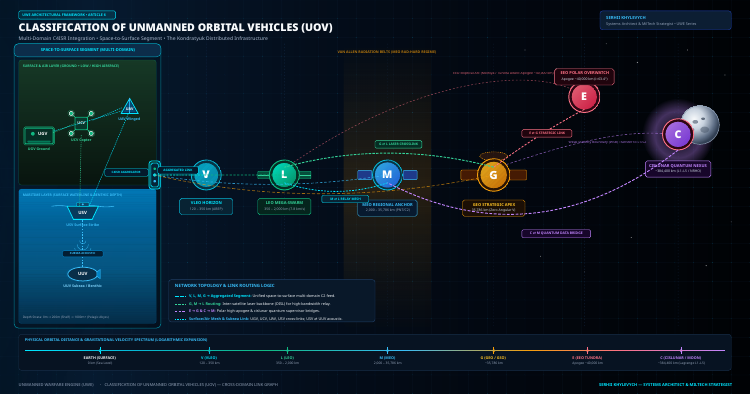

# SUBMISSION PACKAGE: THE SPACE REVIEW

### Editorial Submission Details

| Field | Detail |
| :--- | :--- |
| **Target Publication** | **The Space Review** (`thespacereview.com`) |
| **Recipient Editor** | **Jeff Foust**, Editor & Publisher (`jeff@thespacereview.com`) |
| **Submission Category** | Exclusive Analytical Essay / Contributed Space Doctrine |
| **Author** | **Serhii Khylevych**, Principal Systems Architect |
| **Author Profile** | [LinkedIn: Serhii Khylevych](https://www.linkedin.com/in/serhii-khylevych-aa152322/) |
| **Manuscript Title** | *The Kondratyuk Paradigm: Why Resilient Orbital Defense Demands a Decentralized Nodal Architecture, Not Monolithic Satellites* |
| **Word Count & Assets** | ~2,450 words (excluding pitch memo); High-Resolution Multi-Domain Infographic enclosed; Standard Word `.docx` + Reference `.pdf` |

---

## PART 1: THE EDITORIAL PITCH (Cover Query to Jeff Foust)

**To:** `jeff@thespacereview.com`  
**Subject:** CORRECTION: Full Analytical Manuscript (~2,450 words) — The Kondratyuk Paradigm

Dear Jeff,

Please accept my sincere apologies—in my previous message, I inadvertently attached an abbreviated draft (~950 words) rather than the complete, in-depth analytical manuscript intended for *The Space Review*.

Attached please find the full, comprehensive study (~2,450 words), structured specifically to match *The Space Review’s* editorial scope and standard for rigorous spacepower and operational doctrine analysis:

**"The Kondratyuk Paradigm: Why Resilient Orbital Defense Demands a Decentralized Nodal Architecture, Not Monolithic Satellites"**

Across the Pentagon, U.S. Space Force, and allied space commands, a critical transition is underway: shifting from exquisite, multi-billion-dollar satellites to proliferated Low Earth Orbit (pLEO) constellations. Yet, military space doctrine remains constrained by twentieth-century civilian metrics—classifying spacecraft by dry mass and launch vehicle fairing limits, rather than dynamic Keplerian kinematics and nodal survivability.

This full essay provides the complete architectural framework:
1. **Reclaiming the 1929 Kondratyuk Legacy:** Explores how Ukrainian visionary Yuri Kondratyuk’s seminal calculations in *The Conquest of Interplanetary Space* mathematically formulated the first true distributed orbital architecture—decomposing monolithic spacecraft into specialized, interacting nodes (Nodal Anchors, orbital propellant depots, and excursion modules) a century before Starlink and the SDA's PWSA.
2. **Operationalizing USSF Space Doctrine Publication 1-0 (*Spacepower*):** Analyzes orbital combat through pure physics—why characteristic velocity increment ($\Delta V$) is the true currency of orbital maneuvering, why passive evasive burns in LEO represent an operational trap under directed-energy and kinetic ASAT threats, and how decentralized edge orchestration eliminates single-point satellite failure.
3. **The Six-Character Unmanned Orbital Vehicle (UOV) Taxonomy Matrix ($[\mathbf{O}\mathbf{P}] - [\mathbf{E}\mathbf{M}] - [\mathbf{T}\mathbf{C}]$):** Introduces a standardized, NATO-compatible hardware classification syntax across VLEO, LEO, MEO, GEO, EEO, and Cislunar space.
4. **Cross-Domain Space-to-Surface Resilience:** Demonstrates how orbital sentinels dynamically hand off real-time targeting telemetry to surface, subsea, and ground networks in under 1.8 seconds.

The complete manuscript (~2,450 words, excluding cover note) is attached in both Microsoft Word (`.docx`) and reference PDF (`.pdf`) formats, along with the high-resolution 300 DPI multi-domain architecture infographic.

All models and taxonomies are derived exclusively from unclassified open-source research and published military space doctrine. This comprehensive work is offered exclusively to *The Space Review*.

Thank you very much for your patience and understanding, and I would be honored to have the complete manuscript considered for publication.

Sincerely,

Serhii Khylevych  
Principal Systems Architect  
LinkedIn: https://www.linkedin.com/in/serhii-khylevych-aa152322/

---

## PART 2: THE COMPLETE ESSAY MANUSCRIPT

# The Kondratyuk Paradigm: Why Resilient Orbital Defense Demands a Decentralized Nodal Architecture, Not Monolithic Satellites

### By Serhii Khylevych

---

### Technical & Legal Disclaimer

> **DISCLAIMER ON MATERIAL STATUS:**  
> This operational and architectural analysis represents an original, independent engineering concept authored by Serhii Khylevych (Principal Systems Architect) for open academic and aerospace-defense evaluation. The orbital models, kinematic formulas, and architectural taxonomies presented herein are derived exclusively from unclassified open-source intelligence (OSINT), published space doctrines (including U.S. Space Force Space Doctrine Publication 1-0 *Spacepower*), declassified historical literature, and open international engineering standards (CCSDS, POSIX, OMG DDS).  
> 
> This document contains no proprietary defense contractor technical data, classified operational plans, or export-controlled information under ITAR or EAR. It is published to foster objective discourse on resilient space architectures and distributed autonomous systems.

---

### Introduction: The Monolithic Insolvency of Military Space

The global space domain is undergoing the most radical doctrinal transformation since the launch of Sputnik. For decades, military space architectures rested on an assumption of orbital sanctuary: national security space assets—early warning, signals intelligence (SIGINT), precision positioning, navigation, and timing (PNT), and secure strategic communications—were deployed as exquisite, multi-ton monolithic platforms stationed in Geosynchronous Earth Orbit (GEO) or specialized Molniya regimes. These platforms, often costing upwards of $1.5 billion per satellite, were designed under the premise that the technical barriers to reach them rendered them effectively immune to kinetic interdiction.

That era of orbital invulnerability has permanently closed.

The rapid proliferation of ground-based direct-ascent anti-satellite (DA-ASAT) missiles, high-power co-orbital rendezvous and proximity operations (RPO) inspectors equipped with robotic grappling appendages, terrestrial radio-frequency jammers targeting uplink/downlink frequencies, and high-energy laser dazzlers has transformed orbital space into a contested, congested, and highly lethal combat theater. 

In response, modern military theorists—most notably articulated within the U.S. Space Force’s foundational doctrine, **Space Doctrine Publication 1-0: *Spacepower* (August 2020)**—have recognized **Orbital Warfare** as a distinct martial discipline alongside Space Domain Awareness (SDA), Space Battle Management (SBM), and Space Electronic Warfare (SEW). 

Yet, despite this doctrinal awakening, space acquisition programs and commercial aerospace classifications remain trapped in a twentieth-century conceptual failure: **the obsession with static physical mass and monolithic integration.** 

Space agencies and military procurement organizations still categorize space vehicles by their launch weight:
* *SmallSat / Minisatellite:* $100 – 500\text{ kg}$
* *Medium Satellite:* $500 – 1\,000\text{ kg}$
* *Heavy / Exquisite:* $> 1\,000\text{ kg}$

For an autonomous battle-management algorithm or an orbital intercept director operating under combat conditions, **mass and financial cost are irrelevant vanity metrics.** The survivability, operational endurance, and tactical lethality of an uncrewed orbital platform are governed strictly by physical invariables: **its characteristic velocity reserve ($\Delta V$), thermal dissipation rate, Keplerian orbital plane, line-of-sight geometry, and communication latency.**

To survive modern counter-space threats, the free world must abandon monolithic thinking and return to a foundational principle formulated nearly a century ago: **The Kondratyuk Paradigm.**

---

### 1. The 1929 Precedent: Yuri Kondratyuk and the Distributed Infrastructure

In the conventional Western history of space exploration, the name of the Ukrainian visionary **Yuri Kondratyuk** (born Alexander Shargey, 1897–1942) is almost exclusively tied to a single calculation: **Lunar Orbit Rendezvous (LOR)**. In 1962, when NASA engineer John Houbolt fought the internal agency orthodoxy to select the lunar orbit rendezvous trajectory for the Apollo program, he openly cited Kondratyuk’s self-published 1929 treatise, *The Conquest of Interplanetary Space*.

Yet, reducing Kondratyuk’s intellectual breakthrough to the Apollo lunar module profile misses his greatest contribution to spaceflight engineering: **Kondratyuk was the first to mathematically define a distributed, modular orbital ecosystem.**

In 1929, space theorists such as Konstantin Tsiolkovsky and Hermann Oberth envisioned interplanetary travel through the brute-force paradigm: the "monolithic rocket" that carried all fuel, crew compartments, atmospheric descent shields, and return stages in a single gigantic, integrated vehicle from Earth’s surface directly to the target celestial body.

Kondratyuk categorically demolished this premise:
1. **The Nodal Anchor Concept:** Kondratyuk proved that an integrated mission must be decomposed into specialized orbital nodes. A primary platform remains anchored in a stable, energy-optimized orbit acting as a telemetry relay, energy accumulator, and navigation nexus, while a stripped-down, specialized functional module performs the terminal excursion.
2. **Intermediate Propellant & Maintenance Depots:** He detailed the establishment of orbital servicing depots to store propellant and swap payload packages, divorcing mission duration from the initial liftoff payload limit of the launcher.
3. **Exploitation of Gravitational Manifolds:** Kondratyuk derived trajectories using the gravitational fields of passing bodies for acceleration and deceleration, laying the mathematical groundwork for contemporary transfers along **Weak Stability Boundaries (WSB)** and missions around **Lagrange libration points ($L_1 \dots L_5$)**.

Applied to modern military space architecture, the Kondratyuk Paradigm dictates that **no orbital asset should ever operate as an isolated, self-contained monolith.** 

When an adversary targets a monolithic satellite, a single kinetic slug, directed-energy burst, or high-power jammer destroys the propulsion bus, the multi-million-dollar sensor payload, and the communications processor simultaneously. Under the Kondratyuk Paradigm, spacepower is decomposed into a **distributed cyber-physical mesh of specialized, interacting nodes**—propulsion tugs, passive optical sentinels, quantum routing nodes, and expendable kinetic interceptors—that continuously collaborate across orbital planes.

---

### 2. Operationalizing USSF SDP 1-0: The Physics of Orbital Warfare

In terrestrial warfare, an infantry squad or naval surface vessel can seek cover behind terrain, drop anchor, or reduce throttle to conserve fuel while maintaining position. 

In **Orbital Warfare**, as codified in **SDP 1-0 *Spacepower***, **there is no cover, and there is no stationary posture.** 

Every orbital asset is in perpetual free fall within a gravitational potential well. Survival and tactical maneuvering are dictated not by speed, but by orbital energy:

$$\mathcal{E} = -\frac{\mu}{2a} = \frac{v^2}{2} - \frac{\mu}{r}$$

where $\mu$ is the standard gravitational parameter of Earth, $a$ is the semi-major axis, $r$ is the orbital radius, and $v$ is orbital velocity.

This reality introduces three fundamental operational paradoxes that invalidate conventional satellite engineering:

#### A. The $\Delta V$ Attrition Race
The operational lifespan of a military satellite in combat is measured not in years of solar panel degradation, but in meters per second of remaining characteristic velocity ($\Delta V$). 
When a hostile "stalker satellite" executes an orbital phasing burn to initiate an uncooperative rendezvous, the target satellite must expend precious monopropellant (hydrazine) or electric propulsion propellant (xenon) to alter its orbital plane or altitude. 

Because classical satellites carry a finite, non-refillable fuel budget (typically $\Delta V_{\text{total}} \le 200\text{–}400\text{ m/s}$ for station-keeping), an adversary can force an exquisite $1.5B satellite to deplete its entire multi-year propulsion reserve in a matter of weeks through repeated proximity spoofing—effectively neutralizing the asset without firing a single shot.

#### B. The Starlink Lesson and The Passive Maneuver Trap
The combat record of satellite operations over Ukraine since February 2022 shattered two long-held space defense doctrines:
1. **The Commercial Neutrality Illusion:** Commercial space backhauls and synthetic aperture radar (SAR) constellations were instantaneously weaponized as primary tactical command, control, and target-acquisition pipelines for frontline forces.
2. **The Triumph of Distributed Attritable Mass:** Russia’s military electronic warfare complexes (*Bylina-MM*, *Krasukha-4*, *Tirada-2S*) successfully blinded localized satellite communications, but utterly failed to suppress the overall LEO communications mesh. 
   Why? Because the constellation was distributed across thousands of low-cost, mass-produced nodes executing automated routing. Knocking out three or four nodes simply caused the optical inter-satellite mesh to dynamically re-route data packets around the disrupted sector in milliseconds.

Conversely, passive evasive maneuvering by large satellites creates an operational trap: each evasive burn introduces orbital track uncertainty, disrupts sensor scheduling, and forces downstream ground stations to re-acquire ephemeris data. Without decentralized on-orbit refueling and autonomous collision avoidance, defensive maneuvering degrades mission utility as severely as physical damage.

---

### 3. The Multi-Domain Orbital Architecture: The Space-to-Surface Spectrum

To operationalize the Kondratyuk Paradigm, the **Unmanned Warfare Engine (UWE)** architecture classifies the orbital domain into discrete operational horizons, tying them directly to surface and atmospheric battle networks.



#### The Six Operational Horizons of Orbital Warfare:

1. **VLEO Tactical Horizon (Very Low Earth Orbit, 120–350 km):**  
   *Regime Characteristics:* High residual atmospheric drag (10⁻¹¹ to 10⁻⁹ kg/m³), requiring air-breathing electric propulsion (ABEP) or continuous low-thrust ion compensation.  
   *Tactical Advantage:* Sub-meter optical resolution with miniaturized optics, low RF transmission latency (< 2 ms), and immunity to long-term orbital debris accumulation (dead craft de-orbit naturally within days). Acts as the primary tactical sensor layer directly over contested littoral theaters.
2. **LEO Constellation Horizon (Low Earth Orbit, 350–2,000 km):**  
   *Regime Characteristics:* High orbital velocity ($v \approx 7.5\text{–}7.8\text{ km/s}$), orbital period $\approx 90\text{–}105\text{ minutes}$.  
   *Tactical Advantage:* High-throughput proliferated sensor and data-relay shell. Houses mega-constellations linked via optical Inter-Satellite Links (ISL), providing the global resilient backbone.
3. **LEO Spaceplane Horizon (350–800 km):**  
   *Regime Characteristics:* Rapid inclination switching, reusable aerodynamic lifting-body cross-range during atmospheric entry.  
   *Tactical Advantage:* Rapid responsive insertion, responsive payload hosting, and on-orbit inspection of uncooperative foreign targets.
4. **MEO Tactical Latency Horizon (Medium Earth Orbit, 2,000–35,786 km):**  
   *Regime Characteristics:* Crossing the Van Allen radiation belts; medium orbital periods ($T \approx 12\text{ hours}$).  
   *Tactical Advantage:* The operational home of resilient PNT (GPS/Galileo) and high-throughput sovereign military communications (O3b mPOWER) balancing broad geometric coverage with manageable propagation delays (100–130 ms).
5. **EEO High-Latitude Resilience Horizon (Highly Elliptical Orbits / Molniya & Tundra):**  
   *Regime Characteristics:* Extreme apogee dwell times (> 8 hours over high northern latitudes) with rapid perigee transits.  
   *Tactical Advantage:* Continuous coverage of Arctic choke points and polar navigation routes inaccessible to equatorial GEO satellites.
6. **EMO Cislunar Quantum Nexus Horizon (Cislunar Space & Lagrange Points $L_1 \dots L_5$):**  
   *Regime Characteristics:* Non-Keplerian three-body gravitational dynamics; deep gravitational potential valleys.  
   *Tactical Advantage:* The decisive "high ground" of future spacepower. Hosting persistent space-domain awareness sensors, strategic communications relays, and planetary defense sentinels undetectable against deep-space thermal backdrops.

---

### 4. The Universal 6-Character UOV Taxonomy Matrix

To establish a standardized engineering language across allied forces, the UWE framework introduces the **Six-Character Unmanned Orbital Vehicle (UOV) Taxonomy Matrix**:

$$\mathbf{UOV} = [\mathbf{Physical\text{ }Regime} \cdot \mathbf{Propulsion}] - [\mathbf{Lifecycle} \cdot \mathbf{Mission}] - [\mathbf{Autonomy} \cdot \mathbf{Control}]$$

$$[\mathbf{O}\mathbf{P}] - [\mathbf{E}\mathbf{M}] - [\mathbf{T}\mathbf{C}]$$

| OCTET | VECTOR | CODE & DESIGNATION | OPERATIONAL ATTRIBUTES |
| :--- | :--- | :--- | :--- |
| **OCTET 1** | **1. Orbital Horizon**<br>*(Physical Regime)* | **V** — Very Low Orbit<br>**L** — Low Earth Orbit<br>**M** — Medium Earth Orbit<br>**G** — Geostationary Orbit<br>**E** — Highly Elliptical<br>**C** — Cislunar / Libration | • **V:** 120–350 km; ABEP drag compensation.<br>• **L:** 350–2,000 km; proliferated LEO mesh.<br>• **M:** 2,000–35,786 km; MEO constellations.<br>• **G:** 35,786 km equatorial stationary slot.<br>• **E:** Molniya / Tundra Arctic coverage.<br>• **C:** Earth-Moon Lagrange points L1–L5. |
| | **2. Propulsion Class** | **C** — Chemical Bipropellant<br>**E** — Hall / Gridded Ion<br>**H** — Hybrid Chem-Electric<br>**N** — Nuclear Thermal / Electric<br>**P** — Pulsed Plasma / Magneto<br>**S** — Solar Radiation Sail | • **C:** High impulse, rapid maneuver / burn.<br>• **E:** High Isp, continuous long-duration stationkeeping.<br>• **H:** Dual-mode chemical boost + electric cruise.<br>• **N:** Deep-space high-payload long-range transit.<br>• **P:** High specific impulse electromagnetic thrust.<br>• **S:** Fuel-less photon pressure delta-V. |
| **OCTET 2** | **3. Lifecycle Profile** | **S** — Single-Use Static<br>**R** — Refillable Fuel Hub<br>**M** — Modular Hot-Swap<br>**X** — Atmospheric Return | • **S:** Non-refillable expendable mission bus.<br>• **R:** Standardized in-space docking & refuel port.<br>• **M:** Swappable orbital payload cassettes.<br>• **X:** Reusable lifting-body spaceplane hull. |
| | **4. Tactical Mission** | **R** — Relay / C4ISR Gateway<br>**K** — Kinetic Intercept (ASAT)<br>**E** — High-Energy EW / DEW<br>**L** — Orbital Logistics Depot<br>**P** — Proximity Inspection (RPO)<br>**M** — Multi-Domain Strike Drop | • **R:** Telemetry aggregation & cross-domain link.<br>• **K:** Co-orbital kinetic intercept vehicle.<br>• **E:** High-power RF jammer / laser dazzler.<br>• **L:** Orbital propellant & parts storage tanker.<br>• **P:** Rendezvous & close-in grappling inspection.<br>• **M:** Orbital atmospheric re-entry munition. |
| **OCTET 3** | **5. Tactical Autonomy** | **0** — Direct Ground Tele-Op<br>**1** — Scripted Ephemeris Burns<br>**2** — Edge-AI Collision / RPO<br>**3** — Decentralized Swarm Mesh | • **0:** Ground station in-the-loop control.<br>• **1:** Pre-calculated waypoint burn sequences.<br>• **2:** Autonomous collision avoidance & optical RPO.<br>• **3:** Swarm consensus, distributed task allocation. |
| | **6. C2 Media & Links** | **R** — Classical RF Link<br>**L** — Optical Laser Cross-Link<br>**M** — Dynamic Mesh Radio<br>**Q** — Quantum Entangled Key | • **R:** Standard S/X/Ku/Ka ground dish links.<br>• **L:** 100+ Gbps inter-satellite laser links (OISL).<br>• **M:** Robust peer-to-peer RF mesh topology.<br>• **Q:** Interception-proof quantum cryptographic channel. |

#### Practical Architectural Deconstruction:
* **`VE-MR-3L` (Tactical VLEO Sentinel):**  
  *Very Low Earth Orbit* (`V`), *Air-Breathing Electric Propulsion* (`E`), *Modular Hot-Swap Payload* (`M`), *Tactical C4ISR Relay* (`R`), *Decentralized Collaborative Swarm Autonomy* (`3`), communicating via *High-Bandwidth Optical Laser Cross-Links* (`L`). This platform skims the atmospheric boundary at 180 km, feeding real-time targeting vectors directly to surface assets while remaining physically immune to orbital jamming.
* **`CH-RP-2L` (Cislunar Servicing & Defense Tug):**  
  *Cislunar Libration Orbit* (`C`), *Hybrid Chemical-Electric Engine* (`H`), *Refillable Fuel Architecture* (`R`), *Proximity RPO and Grappling Toolset* (`P`), *Edge-AI Autonomous Collision Computing* (`2`), linked via *Laser ISL* (`L`). A persistent guardian operating in the gravitational balance of the Earth-Moon Lagrange points.

---

### 5. Decoupled Lethality and Cross-Domain Convergence

The definitive principle of the UWE meta-architecture is **Decoupled Lethality (The Hardware Abstraction Layer / HAL).** 

In classical satellite design, the weapons system or sensor is permanently hardwired into the satellite bus. In UWE, an uncrewed orbital platform is modeled as a standardized software interface:

```rust
// Contract: Universal Orbital Kinematic Interface (UWE-HAL)
interface IOrbitalKinematics {
    fn execute_orbital_burn(target_vector: Vector3, burn_duration: Milliseconds) -> Result<BurnTelemetry>;
    fn query_delta_v_reserve() -> DeltaVBudget; // Remaining meters per second
    fn override_collision_limits(mode: CombatMode); // Removes safety margins for intercept/ramming
}
```

This abstraction allows an operational commander to apply the **Decorator Pattern** to an orbital node in real time:
1. **The Peacetime Posture:** A satellite operates as a neutral `LR-SR-1R` (LEO optical Earth-observation platform).
2. **The Wartime Runtime Transition:** Upon detection of an aggressive adversary maneuver, a signed cryptographic directive updates the platform’s runtime state to **One-Way Mission (OWM)**. Safety thresholds on reaction wheels and cold-gas thrusters are overridden, unlocking maximum slew rates. The satellite transforms from a passive observer into an active kinetic or directed-energy defensive node.
3. **Space-to-Surface Handoff:** Targeting coordinates computed by an onboard Edge-AI processor at $T+0$ seconds are transferred across laser cross-links to a LEO gateway node, beamed downward via tactical datalink to an uncrewed surface vessel (USV) in the Black Sea or Persian Gulf at $T+1.2$ seconds, and queued into an autonomous 30mm airburst chain gun at $T+1.8$ seconds.

The strategic outcome is a **seamless cyber-physical kill web** that unites orbital physics with maritime hydrodynamics and terrestrial robotics into a single, unbreakable algorithmic continuum.

---

### Conclusion: A Doctrinal Imperative for Western Space Superiority

The United States and its allies cannot prevail in a protracted great-power conflict by building a handful of exquisite, multibillion-dollar orbital monuments that invite asymmetric destruction. 

Just as the Cossack *chaika* and the modern combat USV proved that ocean physics and distributed mass outmatch displacement on the sea, the **Kondratyuk Paradigm** proves that **orbital survivability belongs to distributed, interacting nodes governed by kinetic realities.**

By adopting a universal architectural classification, abstracting hardware from mission lethality, and treating the orbital horizon as an interconnected component of multi-domain operations, Western defense establishments can forge a space architecture that is not merely hardened against attack, but mathematically insoluble for any adversary to defeat.

The mathematics of distributed spacepower was written in 1929. The engineering reality must be deployed today.

---

### Author Profile

**Serhii Khylevych** is an internationally recognized Principal Systems Architect specializing in autonomous cyber-physical defense systems, distributed edge computing, and multi-domain command-and-control architectures. With over 20 years of systems engineering leadership spanning mission-critical telecommunications, LEO satellite-ground infrastructure, and uncrewed maritime and aerial robotic platforms, he is the creator of the Unmanned Warfare Engine (UWE) framework. He can be contacted via [LinkedIn](https://www.linkedin.com/in/serhii-khylevych-aa152322/) or through *The Space Review* editorial desk.
