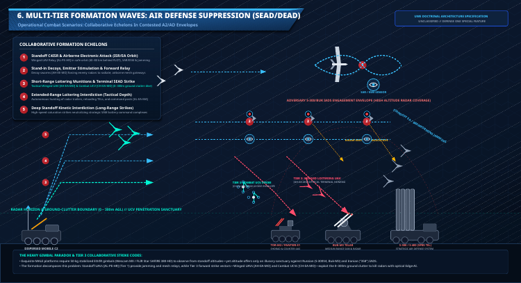
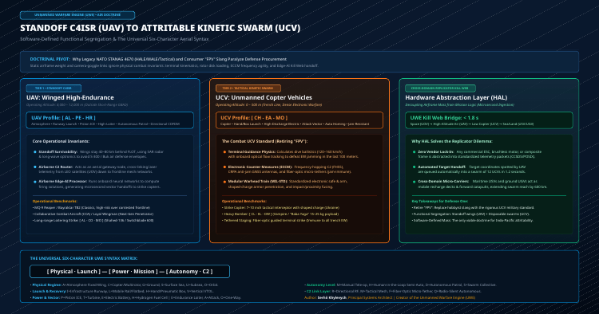

# SUBMISSION PACKAGE: WAR ON THE ROCKS (IN-DEPTH ESSAY)

### Editorial Submission Details

| Field | Detail |
| :--- | :--- |
| **Target Publication** | **War on the Rocks** (`warontherocks.com`) |
| **Section** | In-Depth Analysis / Strategy & Military Operations |
| **Recipient Editors** | **Ryan Evans**, Chief Executive Officer & Editor-in-Chief (`ryan@warontherocks.com`) **Nick Danforth**, Editor (`nick@warontherocks.com`) **General Editorial Desk**: `submissions@warontherocks.com` |
| **Submission Category** | Featured In-Depth Analytical Essay (~2,750 words) |
| **Author** | **Serhii Khylevych**, Principal Systems Architect |
| **Author Profile** | [LinkedIn: Serhii Khylevych](https://www.linkedin.com/in/serhii-khylevych-aa152322/) |
| **Manuscript Title** | *The Death of MALE Sanctuaries and the Rise of the Collaborative Kill Web: Why Contested Air Dominance Belongs to Ground-Clutter Formations and Software-Defined Swarms* |
| **Enclosed Assets** | Clean Word Manuscript (`.docx`), Reference Layout (`.pdf`), Dual High-Resolution Tactical Infographics (`defense_one_formation_waves_fitted.png`, `uav_ucv_architecture_fitted.png`) |

---

## PART 1: THE EDITORIAL PITCH (Cover Query to War on the Rocks)

**To:** `submissions@warontherocks.com`, `ryan@warontherocks.com`, `nick@warontherocks.com`  
**Subject:** ESSAY SUBMISSION: The Death of MALE Sanctuaries and the Rise of the Collaborative Kill Web

Dear Ryan, Nick, and the War on the Rocks Editorial Team,

For three decades, Western air power operated under an operational luxury that has now permanently vanished: uncontested medium-altitude loitering. In the skies above Ukraine and the Red Sea, the icons of the counter-insurgency era—exquisite, non-stealthy Medium-Altitude Long-Endurance (MALE) platforms like the MQ-9 Reaper and Bayraktar TB2—have been systematically driven from contested airspace by layered Russian and Iranian integrated air defense systems (IADS).

In response, defense acquisition risks falling into a fatal procurement trap: attempting to preserve high-altitude standoff surveillance by building ever-larger drones to carry 50-kilogram optical turrets. This creates what I term **The Heavy Gimbal Paradox**—inflating airframes to multi-ton, 30 million dollars price tags that commanders cannot afford to lose, while offering merely an illusion of sanctuary against modern multi-channel surface-to-air missiles.

I have completed an in-depth analytical essay (~2,750 words) drawing on four years of direct frontline engineering under bombardment in Ukraine to outline the physical, tactical, and software architecture required to replace the collapsing MALE paradigm:

**"The Death of MALE Sanctuaries and the Rise of the Collaborative Kill Web: Why Contested Air Dominance Belongs to Ground-Clutter Formations and Software-Defined Swarms"**

The essay examines four core operational transitions necessary for Western air power to survive peer-to-peer conflict:
1. **The Physics of the Ground-Clutter Layer:** Exploiting Earth-curvature geometry ($d \approx 4.12[\sqrt{h_1} + \sqrt{h_2}]$) to demonstrate why the 0–300 meter low-altitude clutter layer is the only survivable ingress corridor against advanced acquisition and engagement radars.
2. **The Multi-Tier Formation Battle Loop (Figure 1):** Decomposing air defense suppression (SEAD/DEAD) into five synchronized echelons—from standoff C4ISR orbits (Tier 1 `AL-PE-HR`) and active decoy stimulation (Tier 2 `AH-EE-MO`) to low-altitude strike vectors combining winged loitering UAVs (`AH-EA-MO`) and agile combat copters (`CH-EA-MO`).
3. **Tactical Invariants & The "Zhdun" (Sleeper) Ambush:** Overcoming multirotor battery limitations by landing forward copters on rooftops and tree lines in power-down sleeper mode (zero thermal and acoustic signature), launching in 1.5 seconds upon radar stimulation and executing terminal dive attacks via onboard optical Edge-AI under total electronic warfare jamming.
4. **The Cyber-Physical UCV Standard & Hardware Abstraction (Figure 2):** Retiring consumer "FPV" slang for the formal Unmanned Copter Vehicle (UCV) engineering standard, and deploying a software-defined Hardware Abstraction Layer (HAL) on POSIX/CCSDS interfaces to defeat prime-contractor vendor lock-in for the Pentagon’s Replicator initiative.

The complete manuscript is attached in Microsoft Word (`.docx`) and reference PDF (`.pdf`) formats, accompanied by two high-resolution tactical architecture diagrams illustrating the complete multi-tier battle loop and the software-defined hardware abstraction layer.

All operational models, taxonomies, and formulas are derived strictly from unclassified open-source intelligence (OSINT), public military doctrine publications, and open engineering standards, with specific vehicle classifications designated as illustrative architectural benchmarks subject to OEM certification against current technical specifications (TTX).

I would be honored to share this analysis with War on the Rocks' readership across the Pentagon, Allied headquarters, and national security research institutes.

Sincerely,

**Serhii Khylevych**  
Principal Systems Architect  
Creator of the Unmanned Warfare Engine (UWE)  
Kyiv, Ukraine  
LinkedIn: https://www.linkedin.com/in/serhii-khylevych-aa152322/

---

## PART 2: THE COMPLETE ANALYTICAL ESSAY

# The Death of MALE Sanctuaries and the Rise of the Collaborative Kill Web
### Why Contested Air Dominance Belongs to Ground-Clutter Formations and Software-Defined Swarms

### By Serhii Khylevych

---

### Technical & Operational Disclaimer

> **DISCLAIMER ON SOURCES AND OEM ENCODING VALIDATION:**  
> All operational models, taxonomies, and architectural frameworks presented herein are derived exclusively from unclassified open-source intelligence (OSINT), public military doctrine publications, and open international engineering standards (CCSDS, POSIX, OMG DDS). Specific vehicle classifications and alphanumeric codes cited as examples serve as illustrative architectural benchmarks. Formal operational adoption, baseline encoding, and deployment of these classifications require empirical validation and certification by original equipment manufacturers (OEMs) and military acquisition authorities against current certified technical performance specifications (TTX).

---

### I. Introduction: The Shattered Heavens and the Crisis of Western Air Doctrine

For three decades after the Cold War, Western air power took for granted an operational luxury that was mistaken for a permanent law of warfare: uncontested aerial sanctuary. From the Balkans and Iraq to Afghanistan, allied aircraft operated in permissive skies where the unmanned aerial vehicle matured into its modern form.

The gold standard was the exquisite, non-stealthy Medium-Altitude Long-Endurance (MALE) turboprop—epitomized by the American MQ-9 Reaper and Turkish Bayraktar TB2. These systems achieved dominance against adversaries lacking radar and electronic attack. A single 30 million dollars aircraft could loiter unchallenged at 15,000 to 25,000 feet for 24 hours, transmitting high-definition video and delivering laser-guided munitions.

The battlefields of Ukraine and the Middle East have shattered this sanctuary forever. Over airspaces saturated with Russian multi-layered ground-based air defenses (GBAD) and Iranian interceptors, non-stealthy MALE airframes have been systematically driven from contested skies.

Yet Western defense ministries remain anchored to twentieth-century airframe classifications. Even as the Pentagon accelerates its **Replicator** initiative to field attritable mass, program offices struggle to bridge the gap between monolithic drones and disposable vectors. To achieve air dominance against peer integrated air defenses (IADS), allied doctrine must abandon the obsolete MALE sanctuary, exploit the physical sanctuary of the ground-clutter layer, and operationalize collaborative multi-tier formation waves governed by software-defined hardware abstraction.

---

### II. The Fall of the MALE Sanctuary, The Heavy Gimbal Paradox, and the Tactical Reconnaissance Formula

The collapse of medium-altitude unmanned flight stems from a fatal doctrinal fallacy: evaluating reconnaissance aviation by **flight ceiling** rather than by the **physics of target detection**. For three decades, Western defense planning categorized unmanned systems according to the altitude tiers codified in **NATO STANAG 4670**: High-Altitude Long-Endurance (HALE), Medium-Altitude Long-Endurance (MALE), and Tactical UAS. This taxonomy assumed that altitude equates to reconnaissance utility and operational safety.

In contested peer warfare, this assumption is lethal. Against modern integrated air defenses—such as Russian S-300V4, Buk-M3, and Tor-M2 batteries, or Iranian "358" loitering surface-to-air missiles—medium altitude is the most exposed sector of the battlespace. A non-stealthy turboprop with a substantial radar cross-section loitering at 20,000 feet is an illuminated beacon visible to search radars at ranges exceeding 250 kilometers. Attempting to survive by pulling back 60 to 80 kilometers behind the forward line of own troops (FLOT) created **The Heavy Gimbal Paradox**.

To resolve tactical targets from a 70-kilometer slant range, optical sensors require massive physical apertures and focal lengths. This necessitates 50-kilogram-class gyro-stabilized electro-optical/infrared (EO/IR) turrets, such as L3Harris Wescam MX-15/20 or Teledyne FLIR Star SAFIRE 380-HD gimbals. Carrying a 50-kilogram payload while maintaining 20 hours of endurance multiplies airframe mass, balloons unit costs to 20 to 35 million dollars, and expands logistical footprints—yielding only an **illusion of sanctuary** against modern active electronically scanned array (AESA) radars.

#### The Tactical Reconnaissance Formula: NATO Class I & II Target Detection vs. Flight Ceiling
More fundamentally, this standoff architecture collapses because **the tactical employment formula of reconnaissance missions is governed by the detection and identification of NATO Class I and Class II targets, not by arbitrary service ceilings**:

$$E_{\text{recon}} = f(R_{\text{detect}}^{\text{Class I/II}}, \sigma_{\text{clutter}}, \tau_{\text{latency}}) \gg f(H_{\text{ceiling}}, T_{\text{endurance}})$$

In modern warfare, decisive tactical targets fall into two distinct categories:
1. **NATO Class I Targets (<150 kg):** Agile FPV/UCV launch teams, loitering munition operators, dispersed infantry weapon teams, and concealed man-portable air defense (MANPADS) positions in treelines.
2. **NATO Class II Targets (150–600 kg):** Mobile air defense radars (e.g., 9S18M1 "Kupol"), tactical command posts, counter-battery radars, and mobile electronic warfare jamming stations (e.g., Borisoglebsk-2, Zhitel).

Under real-world combat conditions—cloud decks below 1,500 meters, battlefield smoke, foliage, and camouflage netting—resolving small NATO Class I and Class II tactical targets (under Johnson's DRI criteria: Detection, Recognition, Identification) from medium altitude is physically impossible due to oblique slant-angle distortion and terrain shadowing. 

Tactical reconnaissance utility is therefore not a function of platform flight ceiling ($H_{\text{ceiling}}$), but **how close a sensor can penetrate to achieve resolving spatial resolution ($R_{\text{detect}}^{\text{Class I/II}}$) while surviving within the ground-clutter horizon**. Standoff MALE cannot solve this equation. Air dominance demands replacing monolithic airframes with **software-defined functional segregation** across collaborative low-altitude formations.

---

### III. The Physics of the Ground-Clutter Layer: Defeating Radar Horizons at 0–300 Meters

If medium altitude is a death trap, where does an attritable unmanned force operate? The answer lies in the fundamental geometry of Earth's curvature and the electromagnetic properties of the ground-clutter boundary.

The geometric line-of-sight distance ($d$) between a surface-based radar antenna and an airborne target is governed by the standard radar horizon equation, accounting for standard atmospheric refraction ($4/3$ Earth radius model):

$$d_{\text{horizon}} \approx 4.12 \cdot (\sqrt{h_{\text{radar}}} + \sqrt{h_{\text{target}}})$$

where $d_{\text{horizon}}$ is expressed in kilometers, and antenna heights $h_{\text{radar}}$ and target altitude $h_{\text{target}}$ are in meters.

Consider the operational contrast between traditional medium-altitude flight and ground-clutter ingress:
* **The MALE Profile:** An aircraft loitering at an altitude of 5,000 meters against a Russian 9S18M1 "Kupol" search radar elevated on a 15-meter mast has a theoretical line-of-sight exposure exceeding **307 kilometers**. Even accounting for atmospheric attenuation and electronic jamming, the platform is tracked and queued for engagement hundreds of kilometers before it can employ tactical munitions.
* **The Ground-Clutter Profile:** An unmanned vector operating at an altitude of 30 meters against the same 15-meter radar mast drops the geometric line-of-sight horizon to approximately **38.5 kilometers**. Over undulating terrain, urban infrastructure, or forested tree lines, topographical screening (terrain masking) compresses this detection threshold to under **12 kilometers**.

Beyond geometric line-of-sight masking, low-altitude flight between **0 and 300 meters above ground level (AGL)** exploits electromagnetic backscatter. When an adversary acquisition radar transmits radio-frequency energy toward the Earth's surface, reflections from terrain, vegetation, buildings, and ground features generate massive **clutter returns**. 

While modern pulse-Doppler radars employ moving target indication (MTI) filters to separate moving targets from stationary terrain, ground clutter significantly degrades radar signal-to-noise ratios. Furthermore, when low-altitude unmanned aircraft maneuver across radial vectors or fly below the radar's minimum Doppler clutter notch velocity ($V_{\text{radial}} \le 25\text{ m/s}$), they become virtually indistinguishable from ambient ground reflections.

By abandoning the false sanctuary of altitude and forcing combat operations into the 0–300 meter clutter layer, unmanned strike forces invert the economic calculus of integrated air defense. A surface-to-air missile battery designed to intercept Mach 3 aircraft at 30,000 feet cannot efficiently engage hundreds of small, low-RCS vectors skimming over tree lines and ravines.

---

### IV. Multi-Tier Formation Waves: Deconstructing the SEAD/DEAD Battle Loop

Operating within the ground-clutter layer solves the problem of ingress survivability, but it introduces an operational constraint: small low-altitude airframes cannot carry long-range synthetic aperture radars or multi-kilowatt electronic attack transmitters.

To resolve this challenge, the **Unmanned Warfare Engine (UWE)** architecture decomposes the air combat mission into synchronized, multi-tier collaborative formation waves. Rather than burdening a single exquisite airframe with sensing, jamming, and kinetic attack, the mission is divided across five specialized echelons executing a deterministic suppression and destruction of enemy air defenses (SEAD/DEAD) battle loop.

As illustrated in **Figure 1**, modern contested air operations deploy five distinct, interoperable formation waves:

#### 1. Tier 1: Standoff C4ISR & Airborne Electronic Attack (The Relay Orbit)
Operating 40 to 80 kilometers behind the forward line of own troops (FLOT) at safe standoff altitudes (8,000–12,000 meters), high-endurance winged platforms—designated under our taxonomy as **`AL-PE-HR`**—maintain protected racetrack orbits. Equipped with synthetic aperture radar (SAR), electronic support measures (ESM), and directional phased-array jammers, Tier 1 provides wide-area situational awareness. Tier 1 aircraft never enter the adversary's surface-to-air missile envelope. Instead, they act as airborne command-and-control (C2) routers, bridging directional data meshes down to forward tactical strike waves.

#### 2. Tier 2: Stand-in Decoys & Emitter Stimulation
To defeat an integrated air defense network, one must first compel it to radiate. Tier 2 deploys waves of low-cost, expendable forward decoys (**`AH-EE-MO`**). Penetrating directly across the adversary's radar horizon, these attritable platforms emit amplified radar signatures and deceptive radio-frequency signals. Their sole objective is **emitter stimulation**: forcing Russian 9S18 Kupol acquisition radars and 9S36 Buk fire-control radars to illuminate, commit tracking channels, and disclose their exact coordinates to Tier 1 ESM sensors and allied Kill Webs.

#### 3. Tier 3: Short-Range Tactical Strike Vectors (Winged UAV & Combat UCV)
Operating strictly within the **0 to 300 meter ground-clutter layer**, Tier 3 represents the decisive tactical strike echelon. Tier 3 synchronizes two distinct aerial classes:
* **Tactical Winged Loitering UAVs (`AH-EA-MO`):** Fixed-wing munitions launched from pneumatic rails or canisters, designed for rapid low-altitude ingress across 15 to 40 kilometers.
* **Agile Combat UCVs (`CH-EA-MO`):** High-thrust multirotor copters capable of vertical takeoff, high-agility hovering, and aggressive terminal dive ballistics.

Screened by terrain masking and radar horizons, Tier 3 vectors close the final distance undetected. Upon receiving microsecond target handoffs from Tier 1 via directional mesh links, Tier 3 platforms pop up from dead ground and execute steep, high-G terminal dive attacks directly onto illuminated radar antennas, mobile command cabins, and launcher rails.

#### 4. Tier 4: Extended-Range Loitering Interdiction
Operating deeper within the adversary's tactical depth (20 to 60 kilometers behind the line of contact), medium-range loitering platforms (**`AL-EA-MA`**) conduct autonomous armed reconnaissance. Their primary mission is interdicting mobile reload transports (transloader vehicles), mobile generators, and repositioning air defense launchers attempting to displace after firing.

#### 5. Tier 5: Deep Standoff Kinetic Interdiction
Complementing tactical low-altitude swarms, Tier 5 deploys high-speed kinetic saturation vectors (**`AL-JA-TA`**). Utilizing turbine propulsion or rocket boosters, Tier 5 assets deliver heavy standoff warheads to neutralize hardened command bunkers, ammunition dumps, and strategic radar complexes identified during the preliminary suppression waves.

By orchestrating these five echelons into a closed collaborative loop, the formation achieves complete functional segregation: **Tier 1 sees and jams from safety; Tier 2 stimulates the enemy to radiate; Tier 3 executes the kill from the ground clutter; and Tiers 4 and 5 dismantle the adversary's operational depth.**

---

### V. Tactical Invariants: The "Zhdun" Sleeper Ambush and Terminal Optical Edge-AI

While low-altitude copters (UCVs) excel in tactical strike lethality, multirotor platforms face a well-known physics constraint: **aerodynamic energy density**. Unlike fixed-wing gliders that generate lift passively across an airfoil, a multirotor must expend continuous electrical energy solely to overcome gravity through propeller thrust. Consequently, active loitering endurance for tactical copters is severely limited.

To convert this physical limitation into an asymmetric tactical advantage, the UWE operational doctrine incorporates the **"Zhdun" (Ambusher/Sleeper) operational mode**.

Instead of wasting battery reserves loitering in mid-air, forward combat UCVs fly low into contested sectors during darkness or electronic diversion and **land on forward rooftops, tree lines, or elevated terrain features**.

Once grounded, the UCV cuts power to its propulsion entirely:
* **Zero Acoustic and Thermal Signature:** With brushless motors powered down, the aircraft generates no propeller noise and negligible thermal signature, blinding acoustic sensors and thermal optics.
* **Milliwatt Standby Draw:** The aircraft enters a sleep state, drawing milliwatts to maintain passive receiver standby. On an internal 21700 lithium pack, a sleeper UCV can maintain its ambush posture for days.

The grounded UCV functions as an **invisible, intelligent, repositionable minefield**. When Tier 1 C4ISR platforms detect an illuminated radar or moving convoy, a microsecond wake-up command triggers the sleeper UCV to spin up its high-discharge motors, lift off within **1.5 seconds**, and execute a terminal dive before target crews can react.

#### Overcoming the Electronic Warfare Wall via Terminal Edge-AI
Along contested front lines in Eastern Ukraine, Russian electronic warfare complexes (such as Krasukha-4, Pole-21, and Borisoglebsk-2) deploy dense barrage jamming across conventional control bands. During the final 100 meters of flight, human-in-the-loop radio-frequency video links degrade precipitously into static snow.

To ensure terminal lethality under complete electronic warfare blackouts, combat UCVs integrate **onboard optical Edge-AI trackers**. 

Operating locally on low-power neural processing units (NPUs) consuming less than 5 watts, the onboard vision model continuously processes raw CMOS camera streams at 60 frames per second. Once an operator or C4ISR link identifies a target at standoff range, the pilot designates the bounding box. From that instant forward, the Edge-AI tracker assumes complete terminal guidance. 

Even if jamming severs the pilot's video feed and command link entirely at 200 meters altitude, the onboard neural network maintains an optical lock on the target's visual contrast and geometric features, computing autonomous control deflections down to the centimeter. The munition strikes with unerring kinetic precision, rendering electronic warfare barrage jamming functionally irrelevant at the terminal moment.

---

### VI. The Cyber-Physical UCV Standard vs. Amateur Hobbyist Nomenclature

The operational success of this tactical battle loop depends upon a doctrinal revolution that Western defense acquisition has resisted: abandoning consumer hobbyist terminology.

As shown in **Figure 2**, the unmanned air domain naturally bifurcates into high-altitude winged C4ISR platforms (UAV) and low-altitude attritable copters (UCV). Yet across the Department of Defense, NATO working groups, and defense prime contractors, the tactical strike copter is routinely labeled an **"FPV drone."**

This terminology is doctrinally catastrophic. First Person View (FPV) describes nothing more than a consumer analog or digital video protocol streaming camera frames to an operator's goggles—a hobbyist term inherited from 2015 recreational quadcopter racing. It communicates zero engineering specifications to an acquisition official, a weapons standardizer, or an industrial manufacturer. Calling a precision-guided strike munition an "FPV drone" is as professionally absurd as classifying the M4A1 carbine as a "red-dot firearm" or designating an AIM-120 AMRAAM as a "heads-up-display missile."

To transition from ad-hoc commercial improvisation to an industrial-scale defense manufacturing base, the Pentagon must retire "FPV" and formally establish the **Unmanned Copter Vehicle (UCV)** military engineering standard.

A combat-grade UCV is defined by four non-negotiable cyber-physical invariants:
1. **Terminal Guidance Physics & Aerodynamic Ballistics:** Unlike horizontal-flight cruise munitions, a tactical multirotor operates across agile vertical and dive vectors. Maintaining aerodynamic control at terminal dive velocities of 120 to 160 km/h in crosswinds requires high rotor disk loadings and dynamic thrust-to-weight ratios (T/W ≥ 2.5).
2. **Electronic Counter-Countermeasures (ECCM):** Commercial video transmitters collapse within minutes of encountering military-grade electronic attack. A combat UCV mandates frequency-hopping spread spectrum (FHSS) links, circularly polarized anti-jam GNSS arrays, or zero-emission fiber-optic micro-tethers offering absolute immunity to radio-frequency jamming.
3. **Modular Warhead Train Safety (MIL-STD-1316):** Battlefield utility requires transitioning from dangerous, improvised wire contacts to certified electronic safe-and-arm devices (ESAD), modular shaped charges, and programmable impact/proximity fuzes.
4. **Energy Chemistry & High-Rate Discharge Profiles:** Consumer batteries overheat and sag under combat acceleration. Combat UCVs require specialized high-rate lithium-ion (21700 cylindrical cells) or lithium-polymer packs engineered for continuous high-discharge rates (45–60C burst) during terminal egress and evasive maneuvers.

#### The Universal Six-Character UWE Syntax
To enable human combat commanders and autonomous AI microservices to manipulate these disparate assets across joint command-and-control networks, the UWE architecture introduces an idempotent, dual-read six-character syntax:

$$\mathbf{Aerial\ Platform} = [\mathbf{Regime} \cdot \mathbf{Launch}] - [\mathbf{Powerplant} \cdot \mathbf{Mission}] - [\mathbf{Autonomy} \cdot \mathbf{Control}]$$

$$[\mathbf{O}\mathbf{P}] - [\mathbf{E}\mathbf{M}] - [\mathbf{T}\mathbf{C}]$$

Under this metric framework, every aerial platform is classified by its physical and cybernetic capabilities rather than its commercial marketing brand:
* **`AL-PE-HR` (Standoff C4ISR UAV):** Atmosphere fixed-wing (**A**), runway infrastructure (**L**), piston engine (**P**), high-altitude loitering endurance (**E**), autonomous patrol (**H**), directional phased-array datalink (**R**).
* **`AH-EA-MO` (Tactical Winged Loitering UAV):** Atmosphere fixed-wing (**A**), hand/canister launch (**H**), high-discharge electric powertrain (**E**), terminal attack vector (**A**), autonomous optical lock (**M**), radio-silent mesh link (**O**).
* **`CH-EA-MO` (Tactical Combat UCV):** Copter vertical-lift (**C**), hand/box launch (**H**), high-discharge electric powertrain (**E**), terminal attack vector (**A**), autonomous optical terminal homing (**M**), radio-silent mesh or tethered link (**O**).

---

### VII. Operationalizing Replicator: Hardware Abstraction and Industrial Attritability

The ultimate strategic payoff of establishing the UCV standard and adopting software-defined formation waves is resolving the Pentagon's most urgent procurement crisis: **prime contractor vendor lock-in**.

Historically, major defense acquisition programs tightly coupled proprietary mission software to bespoke airframe hardware. When a prime contractor developed a military drone, every component—from the flight controller and datalink to the optical gimbal and mission computer—was sealed behind proprietary intellectual property firewalls. Whenever adversary electronic warfare units altered jamming frequencies or fielded new counter-drone countermeasures on the battlefield, the military was forced to wait through a multi-year, multimillion-dollar engineering change proposal (ECP) cycle merely to field a revised radio card.

Against a peer industrial power capable of manufacturing commercial components at staggering volume, this bespoke, slow-cycle procurement model guarantees defeat.

The UWE architecture solves this bottleneck by establishing a software-defined **Hardware Abstraction Layer (HAL)**. 

Operating above open POSIX and CCSDS standardized protocols, the HAL completely decouples high-level mission software—such as cooperative swarm behaviors, automated target recognition (ATR) pipelines, and multi-tier battle loop logic—from the underlying physical airframe. The airframe, electric speed controllers, brushless motors, and carbon-fiber arms are treated as swappable, commoditized execution hardware.

Under this architecture, the Department of Defense can procure carbon-fiber airframes from Ohio, brushless electric motors from domestic suppliers, and speed controllers from Texas. When connected to the tactical bus, the HAL dynamically identifies physical hardware parameters, normalizes motor-mixing algorithms, and ingests the platform into the operational swarm mesh in microseconds.

Furthermore, this abstraction enables seamless **cross-domain synchronization**. An airborne standoff UAV relay (`AL-PE-HR`) detecting an illuminated air defense radar can transmit normalized target telemetry across the joint data mesh to an unmanned surface vessel (USV) in the littoral corridor or an unmanned ground vehicle (UGV) in the tree line. The ground or maritime carrier deploys a canister-launched combat UCV swarm (`CH-EA-MO`), neutralizing the radar within seconds of detection without requiring human manual relay.

---

### VIII. Conclusion: Software-Defined Mass for the Next War

The lessons of the bloody war of attrition in Ukraine are clear and unyielding. The era of the monolithic, non-stealthy MALE drone loitering unchallenged over contested battlefields is over. Nations that continue to invest tens of millions of dollars in single, slow-moving turboprops carrying heavy optical gimbals will find their unmanned fleets destroyed within the opening hours of a peer conflict.

True air dominance in contested airspace will not be achieved by building larger targets. It will be achieved by orchestrating **software-defined collaborative mass**:
* Retiring the hobbyist slang of "FPV" and codifying the rigorous, cyber-physical **UCV engineering standard**.
* Embracing the electromagnetic and geometric sanctuary of the **0–300 meter ground-clutter layer**.
* Decomposing the kill chain into **synchronized, multi-tier formation waves** that bait, jam, and destroy enemy air defenses through collaborative autonomy.
* Decoupling mission software from physical hardware via an open **Hardware Abstraction Layer** that enables the industrial mobilization of commercial mass.

The Pentagon's Replicator initiative cannot succeed on twenty-year-old airframe taxonomies or weekend hobbyist labels. By anchoring military procurement in the unyielding laws of physics, software abstraction, and collaborative swarming, the United States and its allies can convert attritable mass into decisive, war-winning combat power.

***

**About the Author:**  
*Serhii Khylevych is a Principal Systems Architect and creator of the Unmanned Warfare Engine (UWE) meta-architecture. He possesses over two decades of engineering leadership in mission-critical telecommunications, distributed autonomous systems, and defense hardware abstraction.*  
*LinkedIn: [linkedin.com/in/serhii-khylevych-aa152322](https://www.linkedin.com/in/serhii-khylevych-aa152322/)*
